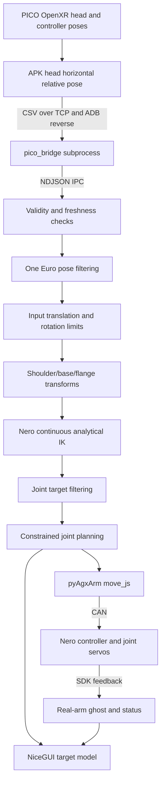

# PICO × AgileX Nero Teleop Host (Base Mounting Edition)

A seven-axis robot-arm teleoperation program based on the **PICO 4 Ultra, continuous analytical inverse kinematics, and the AgileX pyAgxArm SDK**. The operator moves the left and right controllers, and the host converts them into joint-position targets for the corresponding Nero arm. A browser UI provides a 3D model, real-arm feedback, connection control, and mounting-parameter settings.

> **Connect calls the SDK to connect and enable the robot arm; Start moves connected real arms to the Startup Pose and then enters following. STOP stops advancing targets and holds the joints; it is not a physical emergency stop or a power cut.**
>
> **Known unresolved issue (this document only records it faithfully; the related source code was not modified): when real-arm feedback is stale but the SDK socket is still open, the program may keep showing TELEOP, keep the old joint values, and keep sending commands. On 2026-11-08, a field run showed stale warnings with zero passive frames received; the root cause is not yet confirmed and the problem is not yet fixed. In the field, rely on STOP plus manual inspection; see §9.2.**

## Contents

- [1. Introduction and Scope](#1-introduction-and-scope)
- [2. Daily Startup in an Existing Environment](#2-daily-startup-in-an-existing-environment)
- [3. Full Installation Tutorial](#3-full-installation-tutorial)
- [4. Detailed Usage Workflow](#4-detailed-usage-workflow)
- [5. Mounting Orientation and Settings](#5-mounting-orientation-and-settings)
- [6. How Teleoperation Works](#6-how-teleoperation-works)
- [7. Parameter and Command Quick Reference](#7-parameter-and-command-quick-reference)
- [8. File Structure](#8-file-structure)
- [9. Troubleshooting and Known Limitations](#9-troubleshooting-and-known-limitations)
- [10. Verification and References](#10-verification-and-references)

> **Command convention:** Each code block is preceded by a label saying **PowerShell (Windows)** or **Ubuntu (WSL/Ubuntu terminal)** and states the working directory. Lines starting with `# Expected` describe what a successful run should show. Where administrator privileges are required, this is stated separately. Do not paste commands intended for WSL directly into PowerShell.

## 1. Introduction and Scope

This project maps the **6D poses** of the PICO left and right controllers onto the left and right seven-axis Nero arms, and connecting only one side is supported. The algorithm chain includes pose filtering, input step limiting, continuous analytical IK, joint filtering, and velocity/acceleration-limited planning. The NiceGUI page displays the target/simulation model, a green real-arm feedback ghost, coordinate axes, joint-limit margins, and logs; ROS 2 topic output is an optional feature.

| Mode | Startup characteristics | Purpose |
|---|---|---|
| Demo | `--no-pico --demo` | Synthetic poses for checking the UI and algorithms; do not connect a real arm |
| Normal Nero teleop | No demo flag | Real Pico input; use after connecting the real arm on the corresponding side |

**Normal Nero mode is direct pose mapping, not clutch control that only moves while the grip is held.** There is currently no gripper button control, bilateral force feedback, collision planning, or measured payload gravity compensation.

## 2. Daily Startup in an Existing Environment

Start from this section for an existing environment; on a new computer, complete Section 3 first.

| Item | Description |
|---|---|
| Project directory | Local clone/delivery directory, denoted `<project dir>` below |
| Python environment | An activated Python 3.12 venv (see §3.3 for creation) |
| Web port used throughout this tutorial | `8095` (the program default is 8080; if occupied, it increments from that port — trust the terminal output) |

If one computer holds several copies of the source or several Python environments, their `settings.json`, `logs/`, and running processes are independent and changes do not sync between them. Do not start multiple instances on the same port or CAN channel. In the commands below, replace `<project dir>` with your actual source directory.

### Step 1: Attach devices in Windows PowerShell

```powershell
usbipd list
# Replace the two placeholders below with the actual BUSIDs from this list
$PicoBusId = '<PICO_BUSID>'
$CanBusId = '<CAN_BUSID>'
usbipd attach --wsl --busid $PicoBusId
usbipd attach --wsl --busid $CanBusId
```

Run the above in **PowerShell**; the working directory does not matter. In the STATE column of `usbipd list`, `Shared` means the device has been shared, while `Attached` means it is currently passed through to WSL; both devices should show `Attached`. BUSIDs change with the port and machine, so do not copy them blindly. If a device already shows `Attached`, skip the corresponding `attach`; if re-attaching reports `already attached`, you can continue. See Section 3 for the first `bind`, device recognition, and `adb` authorization.

### Step 2: Check and start in Ubuntu

Run in an **Ubuntu-24.04** terminal, not PowerShell:

```bash
adb devices
ip -details link show can0
```

Run the commands above in an **Ubuntu** terminal; the working directory does not matter. Expected: the headset appears in the `adb devices` list with state `device` (not `unauthorized`), and `ip -details link show can0` shows `state UP` and `bitrate 1000000`. Then enter the project directory and start the program:

```bash
cd <project dir>
source .venv/bin/activate     # If you use the project-local venv; otherwise activate your existing environment
env -u PYTHONPATH python run.py --no-browser --port 8095
```

The main terminal should show `NiceGUI ready to go on http://127.0.0.1:8095` (trust this line for the actual port). Standard output from the `pico_bridge` child process is written by `PicoSupervisor` into the web UI's LogBuffer, so ADB/Pico lines such as `ADB reverse ready ...` are usually seen in the web page's **System Log** and are not guaranteed to appear in the main terminal. Keep the terminal running and open the URL in a Windows browser; when finished, return to the terminal and press **Ctrl+C** rather than closing the web page. `env -u PYTHONPATH` prevents other Python workspaces from polluting imports. Do not double-click `run.py`, and do not start a second instance while one is already running.

### Step 3: Start from the web UI

The following example uses a **single left arm** (the left controller drives the left arm); for the right arm or dual arms, substitute the matching side and channel — this is not the only valid configuration.

1. **STOP → Settings**: if the program has just started and is still in the STARTUP motion, click **STOP** first. Choose the mounting orientation for that side, check the Startup Pose, and click **Apply**.
2. **Arm Simulation**: check that the model base matches the physical one.
3. **Connect Arms → Left Arm**: enter `can0` and click Connect on that row.
4. Confirm Pico is CONNECTED and the left controller in use is TRACKED, make sure the startup motion space is clear, then click **Start** and complete the dialog confirmation.
5. Move the left controller in small increments first; press **STOP** when you want to stop.

## 3. Full Installation Tutorial

### 3.1 Hardware and System

| Category | Requirement |
|---|---|
| VR | PICO 4 Ultra, controllers, USB data cable; developer mode and USB debugging |
| Robot arm | AgileX Nero seven-axis arm, matching power supply, correct CAN wiring; single or dual arm |
| CAN | On Linux/WSL, use a SocketCAN adapter (e.g. candleLight/gs_usb or another compatible adapter) |
| OS | Ubuntu 24.04 recommended; on Windows, WSL2 Ubuntu-24.04 works |
| Python | This modified version uses Python 3.12; NiceGUI is pinned to 3.16.0, the rest are in requirements |
| Build tools | `build-essential` on Linux; native Windows needs the Visual Studio C++ toolchain (x64 Native Tools) |
| USB/CAN libraries | `libusb-1.0-0` on Ubuntu (required by pyusb/gs-usb); the gs_usb kernel module |
| Optional ROS | The same Python environment can import rclpy, geometry_msgs, and std_msgs |

The native Windows code supports `agx_cando`, but it requires the vendor backend, drivers, and DLLs; Linux's `can0` cannot be entered directly on Windows. The following sections focus on the WSL2/SocketCAN path that has actually been used.

### 3.2 Obtain the Complete Source Code

Use the complete delivered `analytic_control` folder, not just the entry-point files. You must keep `ui/`, `mounting.py`, `pico_bridge/`, both URDFs, `apk/`, and `third_party/pyAgxArm/`.

The public upstream is [mm-hand/analytic_control](https://github.com/mm-hand/analytic_control). **The current upstream baseline does not include the unpushed local modifications**; the commands below fetch only the upstream baseline and do not mean the local features have been released:

```bash
git clone --recursive https://github.com/mm-hand/analytic_control.git
cd analytic_control
```

If a Git checkout is missing the SDK submodule:

```bash
git submodule update --init --recursive
```

If the SDK is already complete in the delivered copy, there is no need to update it just to start the program. The program imports the in-repo SDK first; the pip latest-version documentation cannot substitute for how the current version behaves.

### 3.3 Ubuntu / WSL Python Dependencies and IK Build

On a new machine, install the system dependencies; on an existing environment, skip what is already done:

Run the following in an **Ubuntu** terminal; the working directory does not matter, and a sudo password is required.

```bash
sudo apt update
sudo apt install -y git build-essential python3.12-dev python3.12-venv adb usbutils can-utils libusb-1.0-0
# Expected: the command returns successfully; if it reports a different adb package name, Ubuntu 24.04 accepts adb or android-tools-adb
```

The first-line comment in `requirements.txt` comes from the old development conda environment `mmhand`; it only suggests "install into the existing environment" and is not a hard requirement. If that conda environment already exists, you can run `conda activate mmhand` and then `pip install` directly without rebuilding a venv; this README uses the project-local venv as the example. Otherwise, prefer activating an existing Python 3.12 venv/Conda first, and create one only when none exists:

```bash
# At the Ubuntu project root; create and activate the project-local venv
python3.12 -m venv .venv
source .venv/bin/activate
# Windows PowerShell equivalent: python -m venv .venv; .venv\Scripts\Activate.ps1
```

Run the following **at the Ubuntu project root** (first `cd` to the project root and activate the venv from §3.3 or your existing environment):

```bash
python -m pip install -r requirements.txt
python -m pip install -e ./third_party/pyAgxArm
python setup.py build_ext --inplace
python -c "import numpy, nicegui, ik_solver; print('Python / GUI / IK imports OK')"
# Expected: prints Python / GUI / IK imports OK; see §9.1 if the build fails
```

The SDK's editable install also installs the dependencies it declares. Do not bypass environment management with `sudo pip` on the system Python.

The Linux build artifact is `ik_solver.cpython-312-...so`; on Windows it is `.pyd`. It is tied to the OS, architecture, and Python version, so rebuild after changing environments. `.pyx` is the algorithm source and `.c` is a generated file.

**Native Windows:** run the same pip/build commands in an existing Python 3.12 environment and the **x64 Native Tools Command Prompt for VS 2022**. Install the official Android Platform-Tools and add `adb.exe` to PATH (or set `PicoConfig.adb_path`). The real arm additionally needs the vendor-provided `python-can-agx-cando` plugin, `cando.dll`, and the USB-CAN adapter driver; these are not in requirements. The SDK documentation gives the plugin installation as follows; run it in the same activated Windows Python environment. If installing the vendor driver also requires administrator privileges, follow the vendor instructions:

```powershell
python -m pip install "git+https://github.com/agilexrobotics/python-can-agx-cando.git"
# Expected: installation succeeds; then install/place cando.dll per the SDK documentation and connect the USB-CAN adapter
```

If these components are missing, use the WSL2 + SocketCAN path.

### 3.4 Windows/WSL2 USB Configuration

Skip this section on native Ubuntu. On a new Windows machine, install in an administrator PowerShell:

```powershell
wsl --install -d Ubuntu-24.04
winget install --interactive --exact dorssel.usbipd-win
```

Run the above in an **administrator PowerShell**; restart when prompted, then open Ubuntu once to finish Linux user initialization. After connecting the devices, run `usbipd list` and confirm the target by device name, not by VID:PID alone. The table below is only an **example**, not an identification result for any particular machine; different devices/firmware vary, so use the actual names from `usbipd list`:

| VID:PID (example) | Device type (example) | Purpose |
|---|---|---|
| `2d40:00b7` | PICO / Android | Headset USB data |
| `1d50:606f` | candleLight USB to CAN | AgileX Nero |
| `2e88:4603` | COM9 serial adapter | Another kind of device, not the SocketCAN path for Nero |

The initial share requires an **administrator PowerShell**; `bind` must run as administrator, while `attach` usually works in a normal PowerShell — if it reports a permission error, switch to an administrator terminal (do not use `--force`). Replace the two example BUSIDs:

```powershell
$PicoBusId = '<PICO_BUSID>'   # Copy the actual BUSID from usbipd list
$CanBusId = '<CAN_BUSID>'
usbipd bind --busid $PicoBusId
usbipd bind --busid $CanBusId
```

Whenever you need to attach later, keep/update those variables in the same PowerShell session:

```powershell
usbipd attach --wsl --busid $PicoBusId
usbipd attach --wsl --busid $CanBusId
usbipd list
```

Expected: both devices show `Attached` in `usbipd list`, and `lsusb` inside WSL lists the corresponding devices. On Access denied, run `bind` in an administrator terminal; do not guess with `--force` to work around filter-driver issues. After attaching, native Windows tools cannot exclusively claim the device at the same time.

### 3.5 Pico Authorization and APK

1. Enable developer mode and USB debugging on the headset, connect it with the data cable, and put the headset on to accept the authorization.
2. After the WSL user completes the USB attach, run `adb devices` in **Ubuntu**; it should show `device`. If adb is not on PATH, set its path in `PicoConfig.adb_path`. The bridge searches in this order: the configured path, `%LOCALAPPDATA%\Android\Sdk\platform-tools\adb.exe`, PATH, and `~/Android/Sdk/platform-tools`.
3. `unauthorized` means you must accept the authorization on the headset; if no device appears, check the data cable/attach/driver.
4. To install or update the APK for the first time, run the following at the project root:

   ```bash
   adb install -r apk/generated_apk/pico_head_relative_pose.apk
   ```

The package name is `com.mmhand.pico_head_relative_pose`. You can confirm installation with `adb shell pm list packages | grep com.mmhand`. Once `run.py` starts, the `pico_bridge` child process automatically performs `adb reverse` and launches the app; **there is no need to reinstall the APK each time, and do not manually start a second bridge**. Run `adb install -r` only for the first install or an APK update.

If Ubuntu ADB permissions are insufficient, check the udev rules and the user's device permissions; you can install `android-sdk-platform-tools-common` and, if needed, add the user to plugdev and log in again. Do not run ADB in both Windows and WSL at the same time and contend for the headset.

You normally do not need to build the APK yourself. To develop the headset app, refer to `apk/Cargo.toml` / `apk/build.sh`: Rust (Cargo.toml requires ≥ 1.82), `cargo apk` (cargo-apk, which must be installed separately), JDK 17, the Android SDK/NDK, and the OpenXR loader; the script defaults to build-tools 32.0.0, android-31, and NDK 25.1.8937393, so check the actual SDK/NDK paths first. Compiling the APK is not part of the daily teleop startup; a failure should not block the teleop environment.

### 3.6 SocketCAN Configuration

Check in Ubuntu:

```bash
lsusb
ip -details link show type can
```

When you have confirmed that the target adapter is `can0` and no robot-arm control process is running:

```bash
sudo modprobe gs_usb
sudo ip link set can0 down
sudo ip link set can0 type can bitrate 1000000
sudo ip link set can0 up
ip -details link show can0
```

If the interface is already UP with the correct bitrate, do not reconfigure it. Reconfiguring or restarting the channel interrupts the current SDK socket, so never do it during teleoperation. **ERROR-ACTIVE is a normal CAN state name**; do not mistake it for a fault. ERROR-PASSIVE / BUS-OFF / STOPPED need investigation.

Passive check:

```bash
timeout 2s candump can0
```

Exiting with 124 when timeout expires is normal. An UP interface does not prove the arm is online; if there are no frames, check power/emergency stop, H/L, grounding, termination resistor, and firmware behavior.

The optional `scripts/can0-persist/install.sh` is a **one-time system-level setup** that modifies:

- `/etc/systemd/system/<channel>.service`: when the device appears, automatically runs `ip link set <channel> type can bitrate 1000000` and brings it `up`;
- `/etc/sudoers.d/analytic-can-reset`: allows the current user to run `systemctl restart <channel>.service` without a password, so `hardware.py` can recover automatically when CAN hangs;
- enables these units and tries one immediate restart. The script can be run repeatedly; the default arguments are `can0 can1`.

Install it manually only when you understand the system changes above, the arm is stopped / the program has exited, and systemd is available; **do not run it while the real arm is moving or during teleoperation**:

```bash
# At the Ubuntu project root; requires sudo
sudo bash scripts/can0-persist/install.sh can0
# Expected: creates/enables can0.service and the sudoers rule, exits without syntax errors
```

It is not required to launch the web UI and does not replace `usbipd attach`; without installing it you can still configure CAN manually with `sudo ip link ...`.

### 3.7 First Software Check

Run the following **at the Ubuntu project root** (demo already implies `--no-pico`, so do not repeat it):

```bash
python run.py --demo --no-browser --port 8095
# Expected: prints NiceGUI ready to go on http://127.0.0.1:<actual port>; no real arm is connected automatically
```

Keep the terminal running and open the URL to check the UI; **do not click Connect Arms in this mode to connect a real arm** (demo mode does not block connecting, and commands are still sent after connecting). After checking, press Ctrl+C to exit, then run with real input (Pico/USB/CAN must already be prepared as described above):

```bash
python run.py --no-browser --port 8095
# Expected: NiceGUI ready in the main terminal; check ADB reverse/Pico status in the web System Log and status bar
```

Starting from `--port`, the program picks the first free port within a **range of 50 ports**; do not keep a demo process running and start a second instance. Copying the project folder, refreshing the web page, or double-clicking a shortcut does not start the service by itself.

### 3.8 First Full Walkthrough Checklist

On a new machine or for the first real-arm session, tick these items in order (the example still uses a single left arm; substitute the side for the right arm or dual arms). If any item fails, stop and troubleshoot in §9 — do not skip ahead:

1. **PowerShell**: both devices are `Attached` in `usbipd list` (the Pico and the CAN adapter).
2. **Ubuntu**: `adb devices` shows `device`; `ip -details link show can0` shows `UP` + `1000000`.
3. **Ubuntu project root**: `python -c "import numpy, nicegui, ik_solver; print('OK')"` prints OK.
4. **Ubuntu project root**: demo starts, the web page opens, and the target model moves with the synthetic controllers (no real arm connected).
5. Real-input startup: Pico status is CONNECTED, the left controller in use is TRACKED, and the rate is non-zero.
6. Check the on-site emergency stop/power/motion range, and confirm the arm is fixed and no one is nearby.
7. **STOP → Settings → Apply**: check the mounting orientation and Startup Pose (Apply is allowed only in STOPPED or pure-simulation TELEOP).
8. **Connect Arms**: for the left arm only, enter `can0`; on success the STOP lock engages and the log shows the firmware and a successful connection.
9. **Start**: tick the "simulation matches the real-arm base" confirmation, and watch the real arm return to the startup pose and enter TELEOP after takeover.
10. Move in small increments first and confirm the direction is correct; on any anomaly press **STOP** immediately, keep the terminal log, and troubleshoot per §9.

## 4. Detailed Usage Workflow

### 4.1 UI Overview

| Area | Contents |
|---|---|
| Connect Arms | Popup with independent left/right channels and Connect / Disconnect; Connect connects and enables, and only after success does the STOP lock engage |
| ROS 2 Output | Top-level switch, off by default; shows UNAVAILABLE when the interpreter lacks rclpy |
| STOP / Start | Stop/hold; after confirmation, return to the startup pose and follow (Start is shown only in STOPPED) |
| Status bar | System stage, Pico rate, tracking, real-arm state, ROS, joint-limit margin |
| Arm Simulation | Blue/orange left/right target models, green real-arm feedback ghost, coordinate axes, and magenta mounting arrows |
| Controllers | Controller poses, validity, buttons |
| Settings | Startup Pose, shoulder/base transforms, mounting orientation, Apply / Restore Defaults |
| System Log | Connection, settings rejection, IK no-solution, tracking and feedback warnings; drag the divider at the bottom to resize |

(In the UI, Power Port Facing is under Settings → Base Frames. This package ships no screenshots, to avoid mistaking simulation screenshots for real-arm acceptance.)

### 4.2 Input and Mounting Preparation

1. Fix the robot arm in place; confirm power, CAN, and the on-site emergency stop, and make sure the startup motion range is free of interference.
2. Start real input; the controller in use should be TRACKED, and Pico should show CONNECTED and a non-zero rate.
3. With no real arm connected yet, check that small controller movements produce sensible target directions in the simulation.
4. Click STOP → Settings, configure the orientation for that side, check the Startup Pose, and Apply; **Apply is rejected while a real arm is following (TELEOP + following)**, so press STOP first.
5. Return to Arm Simulation and compare against the physical base position, orientation, left/right side, and tool direction; do not use viewing-camera rotation as a substitute for the mounting transform.

### 4.3 Connecting Channels

| Scenario (example) | Left Arm | Right Arm |
|---|---|---|
| Single left arm | can0 → Connect | Not connected |
| Single right arm, only adapter can0 | Not connected | Enter can0 manually → Connect |
| Dual arms | Actual left channel, e.g. can0 | Actual right channel, e.g. can1 |
| Native Windows | Vendor index, e.g. 0 | Another index, e.g. 1 |

These connection operations are done in the web **Connect Arms** popup; on Linux enter the SocketCAN name (`can0`/`can1`), and on native Windows enter the vendor device index (`0`/`1`). Left and right cannot share the same channel; duplicate channels are rejected.

A successful Connect will: identify the firmware driver → `connect`/`enable` → check initial feedback → set that side's state **directly to STOPPED** and lock it; it does not go through READY first. **Connect is not a read-only scan; it actually enables the robot arm.** Before connecting, confirm the area around the arm is safe, the arm is fixed, and the emergency stop is available.

### 4.4 Start and Normal Following

1. Check the seven joint angles of the Startup Pose (the UI uses degrees).
2. Put the headset and controllers in the ready pose and click Start; **only when a real arm is connected** does the dialog require ticking "simulation matches the real-arm base".
3. The program runs in sequence: simulation startup trajectory → with a real arm, `_finish_startup()` enters **ALIGNING** → each connected real arm's worker runs `move_j` to the startup pose and switches to `js` servo takeover (about 0.2 s hold) → TELEOP is entered only after all workers finish.
4. First move in small increments in free space and watch the target and feedback; if a target is unreachable, move back into the reachable region.

Normal mode does not require a grip clutch. Head movement can also change the relative controller targets, so do not assume it is unrelated to control. TELEOP is a control-phase label; it alone cannot prove the arm actually reached the pose or that feedback is fresh.

### 4.5 Pause, Remounting, and Exit

- STOP: sets the stop flag and holds the last target, does not advance new teleop targets, and **does not cut enable/torque**. It still sends hold commands to a real arm that has entered following.
- Remounting: press STOP first; Apply is rejected when TELEOP with a real arm following, and also during STARTUP/ALIGNING or while a connection is busy. Start is disabled while a settings transaction is in flight or persistence has not converged.
- Resuming: Start runs the "startup pose + real-arm alignment/takeover" sequence again; it does not resume playback from the paused point.
- Exiting: after parking/supporting the arm properly, press Ctrl+C in the program terminal; closing the web page or shutting the laptop lid does not stop background control, and lid-close/sleep may also drop CAN/USB.
- An SDK disconnect is not the same as a physical power cut; when torque needs to be cut, perform the site procedure specified by the device.
- FAULT: read the System Log first; Start does not clear FAULT, and you usually need to troubleshoot and then restart the whole `run.py` process.

## 5. Mounting Orientation and Settings

**The settings below are explained using the left arm; for the right arm, switch the side to Right and use the corresponding right-side RPY values.** The **Power Port Facing** under each side's **Shoulder to Base RPY (deg)** offers Front / Down / Custom. Selecting a preset backfills that side's RPY from the authoritative matrix; manually editing any RPY number immediately switches to Custom; changes affect control and the 3D view only after Apply.

The first-round RPY values for Front and Down are as follows (Front is the original model baseline; Down is derived from the mounting rotation matrix; left and right are independent):

| Side | Front RPY/° | Down RPY/° |
|---|---|---|
| Left | `(-90,-90,90)` | `(-90,0,90)` |
| Right | `(0,-90,180)` | `(90,0,90)` |

Rotation convention: `R=Rz(yaw)Ry(pitch)Rx(roll)`. The following rotations are left-multiplied onto the Front matrix in the horizon parent frame: `R_down=Rx(-90°)·R_front`. This does not add 90° to any joint, does not change joint zero positions/feedback/limits, and does not clear the translation. Euler angles have gimbal lock, so compare equivalence by rotation matrix, not by angles.

The local reference vector is the base's −X: Front faces horizon-forward (−Z), and Down faces the gravity direction (−Y). The mesh can locate the connector/port panel, but "which socket is the power port and which axis/direction the physical remounting rotates around" remains an **assumption awaiting on-site verification**; mathematical presets and simulation screenshots are not measured calibration. The operator must verify against the physical arm and the magenta reference marker (a line plus an endpoint sphere) before connecting/Start.

### 5.1 How to Change When the Physical Port Faces "Back" or "Up"

The current UI only has Front / Down / Custom built in; **Back and Up are not implemented as presets**. The direction is determined by the matrix, not guessed by flipping a sign in an RPY value: with horizon forward `f=(0,0,-1)`, down `d=(0,-1,0)`, back `b=(0,0,1)`, up `u=(0,1,0)`, and the port local vector `v=(-1,0,0)`, `R_front·v=f`. To keep the same mounting baseline, simply left-multiply a rotation about +X in the horizon parent frame:

| Target orientation | Left-multiplied rotation | Port direction | Left-arm RPY/° (example) | Right-arm RPY/° (example) |
|---|---|---|---|---|
| Front | `Rx(0°)` | `(0,0,-1)` | `(-90,-90,90)` | `(0,-90,180)` |
| Down | `Rx(-90°)` | `(0,-1,0)` | `(-90,0,90)` | `(90,0,90)` |
| Up | `Rx(+90°)` | `(0,1,0)` | `(90,0,-90)` | `(-90,0,-90)` |
| Back | `Rx(180°)` | `(0,0,1)` | `(180,90,0)` | `(0,90,0)` |

How to use (choose one as needed):

1. **Try it on one device only**: set Power Port Facing to **Custom**, enter the left/right RPY values from the table for the corresponding side (using the left column as the left-arm example), and after Apply verify against the physical arm and the magenta reference marker; the two bases are independent, so do not copy the left-arm values to the other side.
2. **Make it a proper preset**: add entries for `Rx(±90°/180°)·R_front` to the preset rotation table in `mounting.py`, and register them in the UI's `Power Port Facing` options/labels; derive the RPY from the matrix with `transforms.rpy_deg_from_rotation_matrix()`, **treating the matrix as authoritative** — do not hand-calculate Euler angles and look only at the numbers. Again: this changes only the mounting frame; it does not change joint zero positions, feedback, limits, or translation.

**Key points:**

- `Rx(-90°)` produces "down", `Rx(+90°)` produces "up", and `Rx(180°)` produces "back"; the angle sign decides up vs. down, and 180° decides front vs. back — it is not just adding a minus sign to one RPY number.
- The RPY values in the table are derived from the matrices using this repository's ZYX/URDF convention and have gimbal-equivalent encodings; after any change, verify with the matrix/reference marker, not just the RPY string.
- If verification shows that the **reference vector itself is reversed** (the physical direction is opposite to the model's local −X), change the sign of `mounting.POWER_PORT_LOCAL_VECTOR` (`(-1,0,0)` ↔ `(1,0,0)`); this flips Front/Back and Down/Up as a whole. Re-verify with the matrix and the magenta marker, and do not compensate by changing joints or limits.

Settings rules:

- `config.py` is the source of defaults; at runtime a `settings.json` is created **at the project root** to store overrides, and `config.py` is not modified. The repository as delivered usually has no such file.
- If you keep multiple source copies/environments, each stores its own `settings.json` and logs and they do not sync automatically; changing one does not affect another running process.
- Apply order: local validation → acquire global settings-transaction ownership → control-thread validation/acceptance (with revision) → 3D sync → write to disk. On rejection, nothing is written and the view is not changed.
- While a transaction is in flight, panel input, Apply, and Restore are disabled; a submission from another open page is explicitly rejected (`another page is applying settings`), and file writes are not interleaved.
- Restore Defaults: applies the `ControlConfig()` defaults and deletes the override file; the Startup Pose also returns to default, but the real arm returns to the new startup pose only on the next Start.
- For an old settings file with no `mounts` section and only manual RPY, both sides adopt the original RPY as `custom`; if the `mounts` label and the RPY matrix disagree, the file is treated as invalid and ignored.
- Open pages sync by revision; unsaved edits are replaced by the new valid configuration during sync, and "Settings changed in another page" is shown.
- If writing/deleting fails, the file snapshot is restored first, then a controller rollback is requested; only when "rollback confirmed **and** file restore succeeded **and** the state was already consistent before the transaction began (`was_converged_before_begin`)" do you see the rolled-back state and is Start allowed. When unconfirmed, the actually effective configuration is shown, and START stays disabled until a healthy Apply/Restore succeeds.

## 6. How Teleoperation Works

### 6.1 Overall Architecture



The parent process contains the UI, control thread, SDK, and optional ROS output; the bridge child process manages ADB, the headset TCP connection, and IPC, so ADB retries do not directly block the control thread.

The default control target is 50 Hz (`MotionConfig.command_hz`) and the GUI refresh is 30 Hz (`GuiConfig.refresh_hz`) as configured values; the 3D scene refresh is fixed at 10 fps (a literal in `ui/scene.py`, not in `config.py`). None of these are hard-real-time or guaranteed display-performance figures, and the browser/GPU may not reach them. The Pico input rate is shown in the status bar; it is the input frame rate, not the joint-command rate.

### 6.2 Pico Capture and Coordinate Definitions

`apk/src/lib.rs` obtains the head and left/right grip poses via OpenXR and requires valid position/orientation. The horizon origin is at the head position and only the horizontal orientation is kept; `yaw_only` normalizes the head quaternion's (y,w) components and clears (x,z).

Let W be the OpenXR local frame, H the horizontal reference frame above, and C the controller:

```text
p_HC = R_WH^T (p_WC − p_WH)
R_HC = R_WH^T R_WC
```

Thus head translation/rotation changes the input mapping. In horizon, +X is right, +Y is up, and −Z is forward; positions are in meters and quaternions are (x,y,z,w).

The APK connects to `127.0.0.1:29761` **inside the headset**; `adb reverse` forwards it to port 9100 on the PC (`PicoConfig.device_port` / `vr_port`), and after parsing, the bridge sends it to the parent over NDJSON at `127.0.0.1:9101` (`IpcConfig.port`). On the wire, each frame is one line of 19-field CSV:

```text
timestamp,left_valid,lpx,lpy,lpz,lqx,lqy,lqz,lqw,right_valid,rpx,rpy,rpz,rqx,rqy,rqz,rqw,left_buttons,right_buttons
```

Parsing checks the field count, the validity bits for both sides (`0/1`), numeric finiteness, and the 32-bit integer range of the buttons; an invalid frame is discarded as a whole. The parent judges pose freshness with the **monotonic clock at PC receive time**: by default a pose older than `0.25 s` is no longer provided upstream, and `0.5 s` is used for the "is input still connected" UI display (`PoseInputConfig`). This is not an end-to-end latency measurement, and the APK's own timestamp does not take part in this decision.

> **Do not connect to 9101 yourself for observation.** This NDJSON IPC maintains only **one client**: a new connection replaces and closes the old one, evicting the running control process and immediately interrupting input. To observe, use the GUI's System Log and keep `logs/control.log`.

The bridge also polls ADB reverse and headset focus: Pico system overlays such as `HandDialogActivity` / `PicoXR_CustomDialog` steal input focus. The focus guard (`PicoConfig.focus_guard`, which checks every 0.5 s by default, with a minimum interval between recovery actions) identifies `mCurrentFocus`, force-stops the configured overlay package (`overlay_package`, default `com.picovr.systemext`), and re-checks focus; a failed focus recovery only logs. It is not a general headset system repair, and do not globally disable hand tracking just for this.

### 6.3 Two-Stage Filtering and Input Limits

One Euro dynamically adjusts the first-order low-pass cutoff frequency by estimating velocity:

```text
dx       = (x − x_prev_raw) / dt
dx_hat   = LowPass(dx, d_cutoff)
cutoff   = min_cutoff + beta * abs(dx_hat)
alpha    = 1 / (1 + 1 / (2π*cutoff*dt))
x_hat    = alpha*x + (1−alpha)*x_hat_prev
```

Slow motion is smoother, and fast motion raises the cutoff frequency to reduce lag. Defaults: `min_cutoff=3`, `beta=0.05`, `d_cutoff=1.0`. Position/pose input uses one filter set, and the seven-dimensional joint targets from IK use another independent filter set (`FilterConfig.pose` / `ik_output`); the parameters are the same but the state is not shared.

- Position is filtered separately on the x, y, and z axes, and each axis can have a different cutoff.
- Orientation first gets `q/−q` sign alignment (to avoid Euclidean component averaging across a sign flip), then its four components are filtered and normalized; this is **not** SLERP/manifold filtering. Only the input rotation limit uses shortest-arc SLERP interpolation.
- The input stage limits position change per step to `min(0.04 m, 2 m/s × dt)` and rotation to `min(0.16 rad, 4 rad/s × dt)`; this is a **controller-target** rate limit, not a real-arm speed limit.
- After IK, the seven-dimensional joint targets first pick the nearest 2π-equivalent angle (to avoid spinning a full turn), then go through One Euro filtering.
- When pose becomes invalid, the position/orientation filter state is cleared and the previous target is held; normal mode does not establish a relative clutch anchor because of this.

### 6.4 Controller-to-Flange Transform Chain

T_AB maps coordinates in B to A; H=horizon, S=that side's shoulder, B=base, C=controller, F=flange:

```text
T_SC = inverse(T_HS) * T_HC
T_SC_scaled: multiply translation by s only, keep rotation
s = robot_size / human_size = 1.45 / 1.0
T_BF = inverse(T_SB) * T_SC_scaled * T_CF
T_HB = T_HS * T_SB
```

What is scaled is the **translation relative to the shoulder**, not all world coordinates or rotations. By default the left/right shoulder x is −0.16/+0.16 m; the tool offset T_CF defaults to translation (0,−0.03,0.065) m and RPY (0,−180,90)°.

The same effective T_SB from frames.py/mounting.py feeds control, the target model, the real-arm ghost, and the axes. Mounting compensation should not be implemented by changing joint zero positions.

### 6.5 Seven-Axis Continuous Analytical IK

`ik.py::NeroIK` wraps the Cython `ik_solver.pyx`; it does not hand the controller's Cartesian target directly to the SDK to solve:

1. The target flange pose is first converted through the fixed offset `T_LINK7_TO_FLANGE` (RPY `(-90,0,-90)`, translation `(0.032,0,-0.0235) m`) into the analytical model's link7 target.
2. The shoulder→wrist distance is clamped to `[1.05×|l_se−l_ew|, 0.95×(l_se+l_ew)]` (`IkConfig.reach_min_ratio` / `reach_max_ratio`); only the end reference point is translated, and not every orientation is guaranteed solvable.
3. Solutions are parameterized by the redundant arm angle theta0, shoulder/elbow/wrist branches are enumerated, and candidates outside the joint ranges are discarded.
4. When a previous-frame solution exists, only 50 local sample points within a `±0.7 rad` window around the previous theta0 are searched; with no previous solution (`theta0_prev is None`), an initial global search is allowed; afterwards `enable_global_fallback=False` by default, so a no-solution case does not silently trigger a global re-search.
5. Candidates are scored using joint velocity/acceleration changes, FK pose error, arm-angle change, and limit cost, with gates on the joint jump for branch switching (0.2 rad) and the minimum gain (0.5).

The actual weights come from IkConfig in config.py, not the solver's bare defaults; in this configuration w_vel=w_acc=0, so you cannot say all scoring terms are enabled. Continuity also comes from the local search, branch gates, filtering, and planning.

No solution returns None; the planner holds the previous target and records the reason, and it does not automatically avoid obstacles. Dimensions, zero conventions, and joint ranges come from `NeroParams.default()`; changing the mesh does not mean the kinematic adaptation is complete.

### 6.6 Joint Planning and the Arm SDK

`motion.py::ArmMotionPlanner` chooses the nearest equivalent angle within limits, constrains target velocity, acceleration, and per-step change, and avoids overshooting the target. The default limit margin is 0.035 rad (about 2°); the first four axes have vmax=0.4 rad/s and the last three 0.5 rad/s, amax is 1 rad/s² for all, and the per-step change is 0.03 rad.

These limits apply to the **sent target**; the device's actual speed and following error are determined by the lower-level controller and the load.

| Stage | Current call in hardware.py / pyAgxArm |
|---|---|
| SDK loading | If the local `third_party/pyAgxArm` exists, insert it into `sys.path` first, then `import pyAgxArm`; choose the Nero and platform backend |
| Connect | Firmware identification (when auto, probe first with `connect`/`enable`), final `connect`+`enable`, check initial feedback; set `speed_percent=20` |
| Startup | In j mode, call move_j along the joint trajectory |
| Takeover | Switch to js and send hold targets for about 0.2 s |
| Teleop | move_js(q), seven-axis joint position commands |
| Feedback | get_joint_angles and get_motor_states for axes 1–7; check that the SDK timestamp advances |
| Transport | Linux SocketCAN / Windows agx_cando, default 1 Mbps |

The firmware driver mapping is decided by `_firmware_name()`: `>=1.20` → `v120`, `1.12–1.19` → `v112`, `1.11` → `v111`, older parseable versions → `default`; an unparseable version string raises an error rather than silently falling back. Field logs have shown `1.21` mapped to `v120`; trust your device's logs. When connecting, `v112/v120` rely directly on the SDK push behavior after `enable()`, while older drivers additionally call `set_normal_mode()` to request CAN push; on old firmware, two consecutive `set_normal_mode()` calls may turn push off again, so the code keeps a 0.2 s interval and a "timestamp still advancing" check. **Do not use repeated firmware guessing or repeated `set_normal_mode` calls as a general fix**: first read `detected Nero arm_firmware` in the log, and only if necessary set `RealArmConfig.firmware` explicitly. An automatic push-retry path for stale feedback exists, but its field limitations are described in §9.2.

Before servo takeover, the mode is explicitly switched `j`→`js` and the SDK's automatic motion-mode switching is disabled, so the host manages j/js. The SDK joint-limit switch defaults to `False` (`sdk_joint_limits_enabled=False`, and the code still calls `set_joint_limits_enabled(False)`), but the host still clips against the joint limits and margins from `NeroParams.default()`; this does not mean the device has no limits or that the SDK side provides no protection.

The host generates position targets, and the motor closed loop runs inside the robot-arm controller. The current planner does not use fresh real-arm error for closed-loop correction; target-model motion cannot be equated with physical following, and this is not a host-side torque controller.

### 6.7 Optional ROS 2 Output

The top-level `ROS 2 Output` switch is off by default. If needed, first make sure the **same interpreter that runs the GUI** can import `rclpy`, `geometry_msgs`, and `std_msgs`; the fact that another shell can run `ros2` does not mean the current venv/conda environment can import them. For ROS installation, prefer a matching official ROS/robostack version in the target environment, and do not put ROS dependencies into requirements.

- Input: `/read_pose/poses`, `/read_pose/buttons`, `/read_pose/tracked`.
- Arm state: `/nero/{left,right}/current_joint_angles_deg`, `target_joint_angles_deg`, `current_end_effector_pose`, `target_end_effector_pose`.
- Joint arrays are in **degrees** and pose positions in meters; the pose `frame_id` defaults to `pose_input_horizon`.

This is only optional topic output and does not automatically create a ROS 2 Control/MoveIt chain; the bridge publishes the input topics and the control process publishes the arm topics. With no arm connected, current values may come from simulation, and even with an arm connected the feedback may be stale; subscribers cannot judge from the topic name alone that a value is a fresh measurement.

### 6.8 Control State Machine and Stop Semantics

The main loop runs the state machine at `MotionConfig.command_hz=50`, and a snapshot is published to the GUI every tick:

| Stage | Meaning and entry condition |
|---|---|
| STARTUP | After launch/Start, the simulation model returns to the Startup Pose along a joint trajectory |
| ALIGNING | Entered first when STARTUP completes and a real arm exists; then each side's worker runs `move_j` to the startup pose → `js` takeover hold, and it ends only when all finish |
| TELEOP | Normal teleop: each tick samples pose → filter/limit → coordinate transform → IK → joint filtering → planning → send to the real arm/update simulation |
| STOPPED | Locked by STOP/connecting a real arm/alignment failure etc.; stops advancing new teleop targets and keeps sending hold targets to following real arms |
| FAULT | Entered through `_fail()` on a control-loop exception or an alignment exception not explained by the stop flag; Start does not clear it, so troubleshoot and restart the process. An ordinary connection failure may only mark that side as ERROR and does not equal a global FAULT |

STOP only sets the stop flag and holds the last target (`_hold_following`); it **does not call `disable` and does not cut torque**. Start goes through `_reset_stop` → restart/align again. Settings changes are accepted only in STOPPED or pure-simulation TELEOP; in TELEOP with a real arm following, STOP is required first. Feedback refresh and command sending are decoupled: when `refresh_feedback()` returns False (stale), the main loop may still be in TELEOP and keep sending targets from old values — this is the source of the unresolved issue in §9.2.

## 7. Parameter and Command Quick Reference

| Parameter | Default and meaning |
|---|---|
| Web UI | `127.0.0.1:8080`; this tutorial usually uses `--port 8095`, and if occupied it increments within 50 ports |
| Pico APK → headset local | TCP `127.0.0.1:29761` |
| ADB reverse → PC receive | headset `29761` → PC `127.0.0.1:9100` (`PicoConfig.vr_port`) |
| IPC | `127.0.0.1:9101`, only one client allowed (do not connect around it) |
| Control / GUI / scene | 50 Hz / 30 Hz (configured) / 10 fps |
| Pose valid / input-connected display | 0.25 s / 0.5 s |
| Real-arm feedback stale | 0.25 s; the current warning/recovery path does **not guarantee** a complete automatic stop |
| SDK speed_percent | 20 (SDK-side ratio before sending targets); separate from host-side target rate limiting |

The following parameters come from `run.py::parse_args`; with `PORT=0` (the default) the `config.py` default is used, and a free port is sought starting from that port within 50 ports:

```text
--no-pico       Do not start pico_bridge, but still wait for IPC input (no bridge means no pose frames); not the same as --demo
--demo          Synthetic input; implies --no-pico and uses DemoPoseSource instead
--headless      Do not start NiceGUI
--duration SEC  Run seconds for headless only; 0 means run until Ctrl+C
--port PORT     Preferred web port (default 0 → 8080)
--vr-port PORT  PC Pico receive port (default 0 → 9100)
--ipc-port PORT Inter-process port (default 0 → 9101)
--no-browser    Do not open the browser automatically
```

Common combinations (run **at the Ubuntu project root**):

```bash
python run.py --demo --no-browser --port 8095              # Offline UI check, no real arm
python run.py --no-browser --port 8095                     # Real Pico + connectable real arm
python run.py --demo --headless --duration 2               # Synthetic input self-test without UI, exits after 2 s
```

Use Settings for mounting orientation/startup pose; filtering, IK, rate limits, and tool offset are mainly in `config.py`. After changing source code you must end the old process and restart; refreshing the browser does not reload Python. `--headless --duration` can be used for an offline startup check without opening the web page.

## 8. File Structure

```text
analytic_control/
├── run.py                 # Main entry, port selection, child-process supervision and cleanup
├── config.py              # Immutable config classes and default parameters
├── controller_state.py    # Snapshots, commands, settings transactions, and global ownership
├── control_loop.py        # Startup/alignment/teleop/stop state machine
├── hardware.py            # SDK loading, firmware, CAN, j/js, and feedback
├── joint_feedback.py      # Joint and motor feedback reads, format checks
├── ipc.py                 # TCP/NDJSON and Pico text-frame parsing
├── pose_source.py         # Real-Pico/demo input sources and freshness
├── filters.py             # One Euro, quaternion handling, input limits
├── frames.py              # Controller/shoulder/base/flange transform chain
├── mounting.py            # Single source of truth for mounting presets
├── transforms.py          # Rigid transforms, quaternions, RPY
├── ik.py                  # NeroIK wrapper, flange offset, reach range
├── ik_solver.pyx          # Cython analytical IK/FK and continuous branches
├── setup.py               # Builds ik_solver
├── motion.py              # Limits, velocity/acceleration limits, startup trajectory
├── settings_store.py      # settings.json validation/migration/saving/restore
├── logging_utils.py       # UI, console, and rotating file logs
├── ros_output.py          # Optional Nero state topics
├── read_joints.py         # Standalone read tool; do not mix casually with real-arm control
├── pico_bridge/
│   ├── __main__.py        # Child-process CLI and parent-exit monitoring
│   ├── bridge.py          # ADB/TCP/IPC, state, and focus
│   └── ros_output.py      # Optional /read_pose topics
├── ui/
│   ├── app.py             # Layout, buttons, status refresh
│   ├── scene.py           # URDF/STL, target and feedback ghosts
│   ├── controllers.py     # Controller page
│   └── settings.py        # Form, mounting orientation, commit/restore
├── apk/
│   ├── src/               # Rust/OpenXR and TCP sending
│   ├── java/              # Android Activity
│   ├── generated_apk/     # Installable APK
│   ├── runtime_libs/      # OpenXR loader
│   └── build.sh           # Optional APK build/signing
├── nero_urdf/             # Nero model and meshes
├── third_party/pyAgxArm/  # AgileX SDK submodule
├── scripts/can0-persist/  # Optional CAN systemd/permission installer
├── test/                  # Offline algorithms, fake hardware, IPC, GUI regression
├── requirements.txt       # Python dependencies
├── settings.json          # Generated at runtime, local overrides
└── logs/                  # control.log and rotated logs
```

`.so/.pyd`, `ik_solver.c`, `build/`, and `__pycache__/` are build/runtime artifacts, not a second algorithm. Historical acceptance records from the upstream development docs do not represent acceptance on the current real arm.

## 9. Troubleshooting and Known Limitations

### 9.1 Find the Entry Point by Symptom

| Symptom | Check first |
|---|---|
| Web page unreachable | Whether the program terminal is running, any exceptions, the actually printed port |
| Orientation control missing | Whether the modified version is running; end the old process, restart, then refresh |
| ik_solver import failure | Rebuild with build_ext in the same Python/platform |
| Pico WAITING/0Hz | adb devices, headset authorization, APK, USB attach |
| Pico CONNECTED but controller LOST | Headset worn, tracking, Controllers, app focus warnings |
| can0 does not exist | usbipd Attached, lsusb, gs_usb; do not mistake COM9 |
| ERROR-PASSIVE/BUS-OFF | After parking/supporting the arm and exiting the program, check power, wiring, bitrate, and termination resistor; if can0-persist is installed you can `sudo systemctl restart can0.service`, otherwise use the standalone §3.6 commands to down, set bitrate, and up in order |
| CAN stays down after replugging | Exit the program first, then `sudo systemctl restart can0.service` (auto bounce); without the script, reconfigure manually; do not run while the real arm is moving |
| IK found no solution | Target/pose/limits or local search has no solution; move back into the reachable region |
| another page applying | Wait for the other page to finish, then retry |
| not persisted/Start blocked | Disk write or rollback did not converge; fix file access, then Apply/Restore |
| ROS UNAVAILABLE | Normal teleop can leave it off; if needed, check the ROS libraries for the same interpreter |
| WSL localhost proxy warning | Do not judge failure from the warning alone; check local HTTP and subsequent logs |

### 9.2 The Real Arm Suddenly Stops Moving

1. STOP first, note the time, and do not repeatedly Start or blindly reconnect.
2. Check the Pico rate and TRACKED; invalid input holds the previous target.
3. Check IK holding / target recovered; an unreachable target pauses advancement.
4. Check `joint feedback unavailable ... stream is stale`, `re-requested CAN push`, and CAN state.
5. After keeping the logs and stopping, you can passively check with `timeout 2s candump can0`; if frames exist, tell the types apart, and a lack of frames does not directly prove motor damage.

**Known software issue (not fixed; this document only records it):** when feedback is stale but the SDK socket is still open, `refresh_feedback()` returns `False` and warns/attempts a push recovery; the main loop **may still keep the old joint values, show TELEOP, and keep sending commands**. On 2026-11-08, such `stream is stale` warnings occurred in the field, and passive `candump` received zero frames; the exact physical cause is not finally confirmed. This round only revises documentation; **that source-code path was not modified and the problem remains unresolved**. Do not use TELEOP or the green ghost to judge that real-arm feedback is fresh.

Another path, where the SDK socket is actually closed, marks ERROR and locks STOP. You cannot therefore claim that "all feedback timeouts automatically stop everything". On abnormal feedback, have the operator stop first and check power, emergency stop, wiring, and driver state before deciding to resume.

### 9.3 Capability Boundaries

- No self-collision or environment-collision detection, and not every controller target is guaranteed reachable.
- No host-side torque closed loop, bilateral force feedback, or measured gravity compensation.
- The physical mounting axis must be verified on the real arm; mathematical verification does not equal passed calibration.
- Closing/freezing the web page in the background is not a verified hardware-stop trigger.
- Target sending, SDK feedback, and freshly measured arrival are different facts; the ghost and TELEOP cannot substitute for accuracy acceptance.
- WSL USBIP and the browser are not hard-real-time links; real GPU frame rate and end-to-end latency have not been fully accepted.

## 10. Verification and References

### 10.1 Offline Verification

In the same environment and at the project root, with no real robot arm connected:

```bash
# Ubuntu project root, and do not connect a real robot arm
python -m pytest -q -p no:cacheprovider
python run.py --demo --no-browser --headless --duration 2
# Expected: tests pass; the headless run exits after 2 seconds
```

This delivery package (main baseline + base-mounting feature) recorded a full test run of **147 passed** (2026-11-10) in a pure simulation environment; it only proves this package's algorithms, fake hardware, IPC, and simulated GUI regression pass, and does not represent real-arm load/safety/accuracy. The full development branch has separate historical acceptance records that do not apply to this package. Default logs are `logs/control.log` and rotated files; when troubleshooting, keep the logs from before and after the incident plus the current configuration, and redact irrelevant information such as headset serial numbers when sharing.

### 10.2 Reference Projects

The following projects are used to learn how to organize documentation around "environment → communication → startup → usage → troubleshooting". Control parameters follow this source code; their device commands were not copied:

- [mm-hand/analytic_control upstream](https://github.com/mm-hand/analytic_control).
- [AgileX official pyAgxArm](https://github.com/agilexrobotics/pyAgxArm): SDK, firmware, and CAN; prefer the Nero API documentation bundled with the SDK when available.
- [Key-Zzs/agilex_teleop Chinese README](https://github.com/Key-Zzs/agilex_teleop/blob/main/README_zh-CN.md): Nero environment and hardware layering; its LeRobot dependencies are not dependencies of this project.
- [enactic/openarm_teleop](https://github.com/enactic/openarm_teleop) and its [teleoperation docs](https://docs.openarm.dev/teleop/): distinguishing one-way position from bilateral force feedback; this project does not implement the latter.
- [Microsoft: Connecting USB devices to WSL](https://learn.microsoft.com/windows/wsl/connect-usb): installing usbipd and sharing/attaching.

Third-party SDKs and models follow their own licenses; this README does not re-grant licenses. When reporting an issue, provide the source version, OS, Python, startup command, key logs, and redacted configuration — not just a "connected" screenshot.
