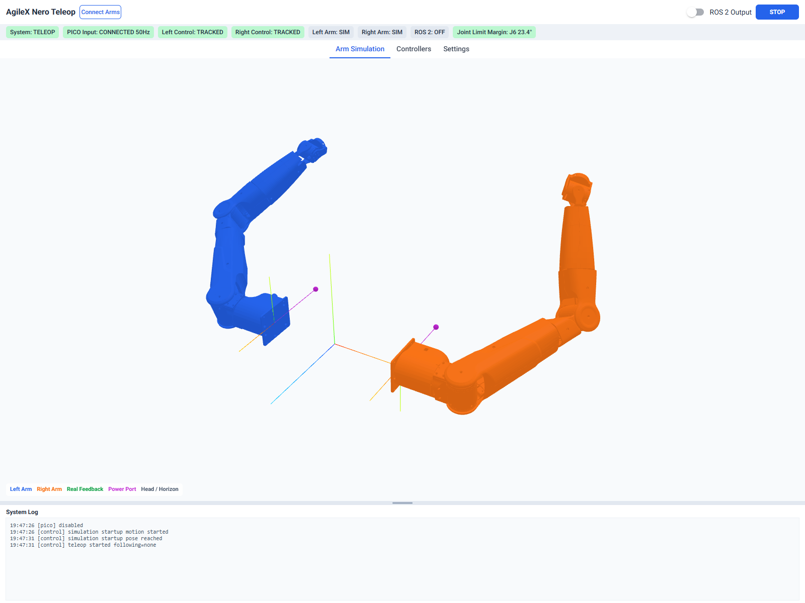
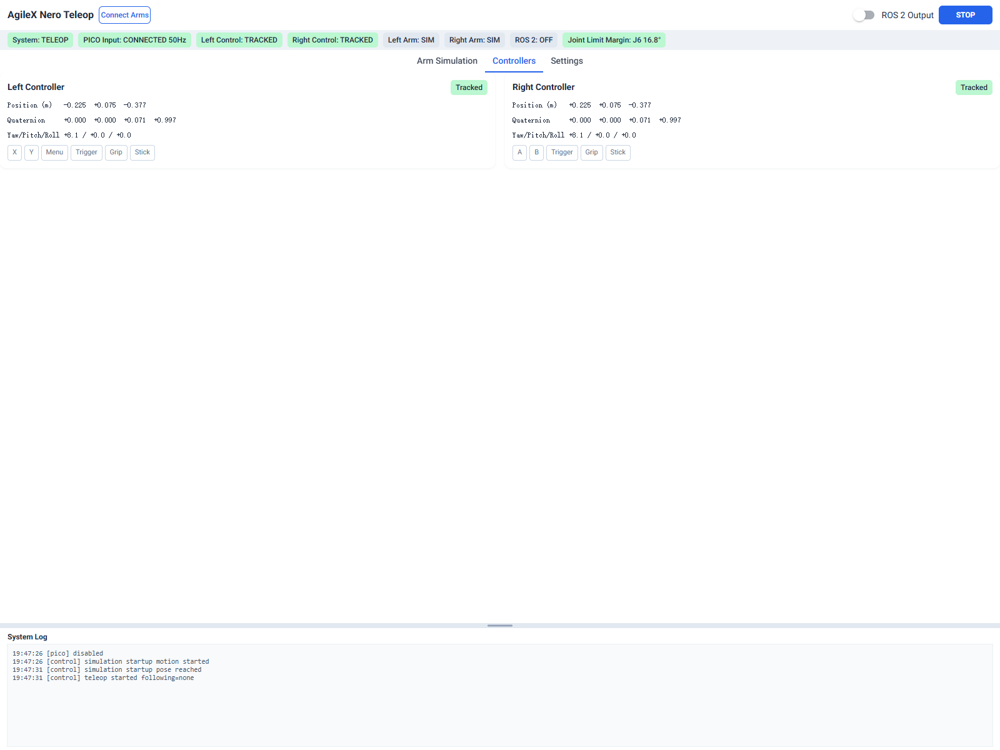
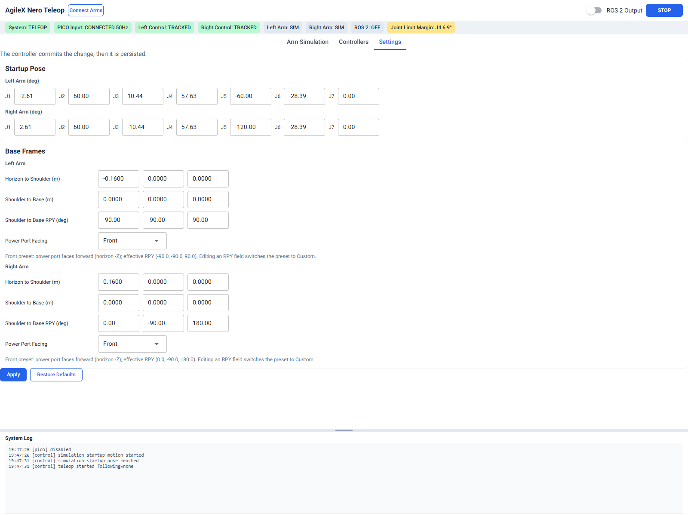
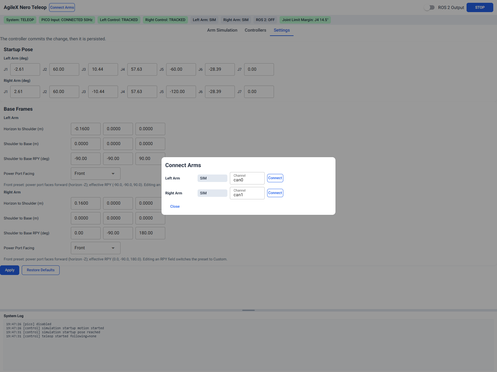
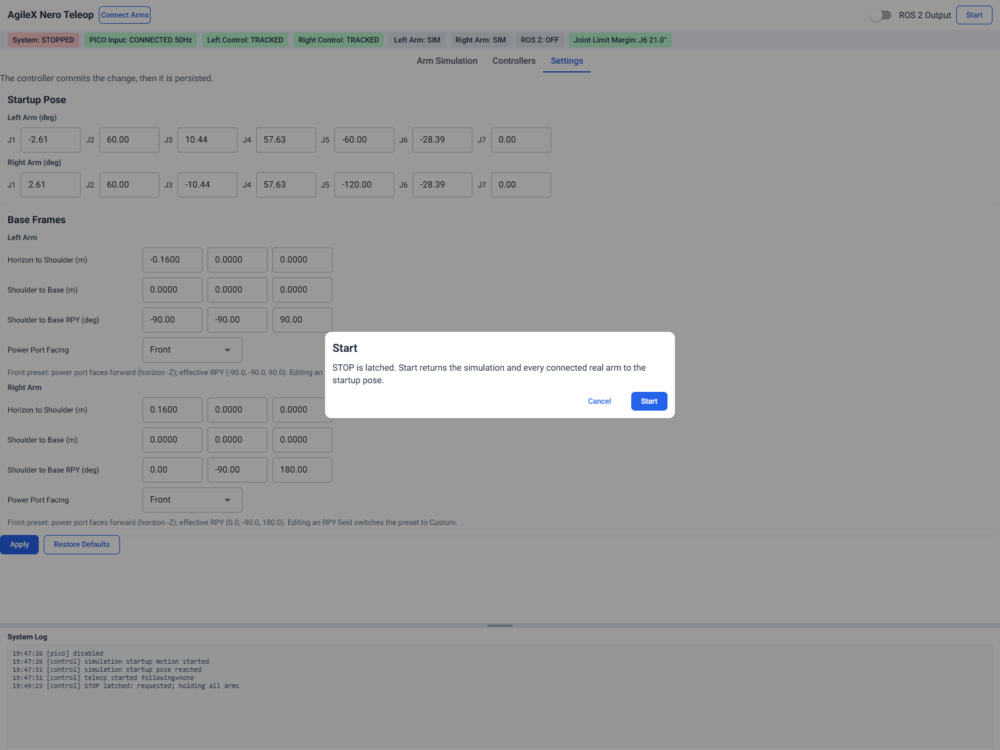

# PICO × AgileX Nero Teleop Host (Base Mounting Edition)

PICO 4 Ultra controller teleoperation for AgileX Nero seven-axis arms. The host converts controller poses into joint targets and provides a browser UI for the 3D model, real-arm feedback, connection control, and mounting settings.

> **Connect calls the SDK to connect and enable the robot arm; Start moves connected real arms to the Startup Pose and then enters following. STOP stops advancing targets and holds the joints; it is not a physical emergency stop or a power cut.**

## Contents

- [1. Introduction and Scope](#1-introduction-and-scope)
- [2. Daily Startup in an Existing Environment](#2-daily-startup-in-an-existing-environment)
- [3. Full Installation Tutorial](#3-full-installation-tutorial)
- [4. Detailed Usage Workflow](#4-detailed-usage-workflow)
- [5. Mounting Orientation and Settings](#5-mounting-orientation-and-settings)
- [6. How Teleoperation Works](#6-how-teleoperation-works)
- [7. Parameter and Command Quick Reference](#7-parameter-and-command-quick-reference)
- [8. File Structure](#8-file-structure)
- [9. Troubleshooting](#9-troubleshooting)
- [10. Verification](#10-verification)

## 1. Introduction and Scope

PICO left/right controller poses are mapped to the corresponding Nero arms; connecting one side only is supported. The control chain covers pose filtering, input limiting, analytical IK, joint filtering, and motion planning. The UI shows the target model, real-arm ghost, axes, joint-limit margin, and logs; ROS 2 output is optional.

| Mode | Startup characteristics | Purpose |
|---|---|---|
| Demo | `--no-pico --demo` | Synthetic poses for checking the UI and algorithms; do not connect a real arm |
| Normal Nero teleop | No demo flag | Real Pico input; use after connecting the real arm on the corresponding side |

**Normal Nero mode is direct pose mapping, not clutch control that only moves while the grip is held.** There is currently no gripper button control, bilateral force feedback, collision planning, or measured payload gravity compensation.

## 2. Daily Startup in an Existing Environment

Start here when the Linux host already has the environment; on a new machine, complete Section 3 first.

| Item | Description |
|---|---|
| Project directory | Local clone/delivery directory, denoted `<project dir>` below |
| Python environment | An activated Python 3.12 venv (see §3.3 for creation) |
| Web port used throughout this tutorial | `8095` (the program default is 8080; if occupied, it increments from that port — trust the terminal output) |

If one computer holds several copies of the source or several Python environments, their `settings.json`, `logs/`, and running processes are independent and do not sync between them. Do not start multiple instances on the same port or CAN channel. In the commands below, replace `<project dir>` with your actual source directory.

### Step 1: Check Pico and CAN on the Linux Host

Run in a native Linux terminal:

```bash
lsusb
adb devices
ip -details link show can0
```

Expected: `adb devices` lists the headset as `device` (not `unauthorized`), and `ip -details link show can0` shows `state UP` with `bitrate 1000000`. If `can0` does not exist, complete §3.4 and §3.6 first. If the headset is `unauthorized`, put it on and accept the USB-debugging prompt.

### Step 2: Start the Host

```bash
cd <project dir>
source .venv/bin/activate     # If you use the project-local venv; otherwise activate your existing environment
env -u PYTHONPATH python run.py --no-browser --port 8095
```

Expected:

- Main terminal: `NiceGUI ready to go on http://127.0.0.1:8095` (the actual port may differ).
- ADB/Pico status: check **System Log** in the web UI.
- Open the printed URL, keep this terminal running, and press **Ctrl+C** to stop. Do not start a second instance.

### Step 3: Start from the Web UI

The following example uses a **single left arm** (the left controller drives the left arm); for the right arm or dual arms, substitute the matching side and channel — this is not the only valid configuration.

1. **STOP → Settings**: if the program has just started and is still in the STARTUP motion, click **STOP** first. Choose the mounting orientation for that side, check the Startup Pose, and click **Apply**.
2. **Arm Simulation**: check that the model base matches the physical one.
3. **Connect Arms → Left Arm**: enter `can0` and click Connect on that row.
4. Confirm Pico is CONNECTED and the left controller in use is TRACKED, make sure the startup motion space is clear, then click **Start** and complete the dialog confirmation.
5. Move the left controller in small increments first; press **STOP** when you want to stop.

## 3. Full Installation Tutorial

### 3.1 Hardware and System

| Category | Requirement |
|---|---|
| VR | PICO 4 Ultra, controllers, USB data cable; developer mode and USB debugging |
| Robot arm | AgileX Nero seven-axis arm, matching power supply, correct CAN wiring; single or dual arm |
| CAN | A SocketCAN adapter (e.g. candleLight/gs_usb or another compatible adapter); native Linux only |
| OS | Native Linux; Ubuntu 24.04 recommended |
| Python | Uses Python 3.12; NiceGUI is pinned to 3.16.0, the rest are in requirements |
| Build tools | `build-essential` and a working GCC toolchain |
| USB/CAN libraries | `libusb-1.0-0` (required by pyusb/gs-usb) and the `gs_usb` kernel module |
| Optional ROS | The same Python environment can import rclpy, geometry_msgs, and std_msgs |

All commands in the following sections run in a native Linux terminal.

### 3.2 Obtain the Complete Source Code

Use the complete delivered `analytic_control` folder, not just the entry-point files. You must keep `ui/`, `mounting.py`, `pico_bridge/`, both URDFs, `apk/`, and `third_party/pyAgxArm/`.

Public upstream: [mm-hand/analytic_control](https://github.com/mm-hand/analytic_control). If you already have the delivered folder, skip the clone:

```bash
git clone --recursive https://github.com/mm-hand/analytic_control.git
cd analytic_control
```

If a Git checkout is missing the SDK submodule:

```bash
git submodule update --init --recursive
```

If the SDK is already complete in the delivered copy, there is no need to update it just to start the program. The program imports the in-repo SDK first; the pip latest-version documentation cannot substitute for how the current version behaves.

### 3.3 Linux Python Dependencies and IK Build

On a new machine, install the system dependencies; on an existing environment, skip what is already done:

```bash
sudo apt update
sudo apt install -y git build-essential python3.12-dev python3.12-venv adb usbutils can-utils libusb-1.0-0
# Expected: the command returns successfully; Ubuntu 24.04 provides adb and android-tools-adb
```

Use an existing Python 3.12 venv/conda environment if you have one; otherwise create a project-local `.venv`:

```bash
# At the project root; create and activate the project-local venv
python3.12 -m venv .venv
source .venv/bin/activate
```

Run the following **at the project root**:

```bash
python -m pip install -r requirements.txt
python -m pip install -e ./third_party/pyAgxArm
python setup.py build_ext --inplace
python -c "import numpy, nicegui, ik_solver; print('Python / GUI / IK imports OK')"
# Expected: prints Python / GUI / IK imports OK; see §9.1 if the build fails
```

The SDK's editable install also installs the dependencies it declares. Do not bypass environment management with `sudo pip` on the system Python.

The Linux build artifact is `ik_solver.cpython-312-...so`. It is tied to the OS, architecture, and Python version, so rebuild after changing environments. `.pyx` is the algorithm source and `.c` is a generated file.

### 3.4 Linux Device Access and Checks

Connect the Pico and the candleLight USB-CAN adapter directly to the Linux host (a USB hub is acceptable if it is powered and stable). Check that the kernel and user session can see them:

```bash
lsusb
adb devices
ip -details link show type can
```

Expected: the Pico appears as an Android/ADB device, and the CAN adapter appears as a SocketCAN interface (for example `can0`). If `adb` says `no permissions` or the device is missing:

- install the udev rules: `sudo apt install android-sdk-platform-tools-common`;
- add your user to `plugdev` if required, then log out and back in: `sudo usermod -aG plugdev "$USER"`;
- reconnect the headset and re-run `adb devices`;
- close other ADB servers/clients if they contend for the same headset.

For the CAN adapter, load the kernel module and check the interface:

```bash
sudo modprobe gs_usb
ip -details link show type can
```

If the interface name is not `can0`, use the actual name in all later commands. Do not run multiple programs that claim the same CAN interface; only one control process may own it.

### 3.5 Pico Authorization and APK

1. Enable developer mode and USB debugging on the headset, connect it with the data cable, and put the headset on to accept the authorization.
2. Run `adb devices`; it should show `device`. If adb is not on PATH, set its path in `PicoConfig.adb_path`; the bridge searches the configured path, PATH, and `~/Android/Sdk/platform-tools`.
3. `unauthorized` means you must accept the authorization on the headset; if no device appears, check the USB cable, udev permissions, and the USB port.
4. To install or update the APK for the first time, run the following at the project root:

   ```bash
   adb install -r apk/generated_apk/pico_head_relative_pose.apk
   ```

The package name is `com.mmhand.pico_head_relative_pose`. You can confirm installation with `adb shell pm list packages | grep com.mmhand`. Once `run.py` starts, the `pico_bridge` child process automatically performs `adb reverse` and launches the app; **there is no need to reinstall the APK each time, and do not manually start a second bridge**. Run `adb install -r` only for the first install or an APK update.

You normally do not need to build the APK. For headset-app development, see `apk/Cargo.toml` / `apk/build.sh` (Rust ≥ 1.82, cargo-apk, JDK 17, Android SDK/NDK). Daily teleop only needs the prebuilt APK.

### 3.6 SocketCAN Configuration

Check in a Linux terminal:

```bash
lsusb
ip -details link show type can
```

When you have confirmed that the target adapter is `can0` and no robot-arm control process is running:

```bash
sudo modprobe gs_usb
sudo ip link set can0 down
sudo ip link set can0 type can bitrate 1000000
sudo ip link set can0 up
ip -details link show can0
```

If the interface is already UP with the correct bitrate, do not reconfigure it. Reconfiguring or restarting the channel interrupts the current SDK socket, so never do it during teleoperation. **ERROR-ACTIVE is a normal CAN state name**; do not mistake it for a fault. ERROR-PASSIVE / BUS-OFF / STOPPED need investigation.

Passive check:

```bash
timeout 2s candump can0
```

Exiting with 124 when timeout expires is normal. An UP interface does not prove the arm is online; if there are no frames, check power/emergency stop, H/L, grounding, termination resistor, and firmware behavior.

The optional `scripts/can0-persist/install.sh` is a **one-time system-level setup** that modifies:

- `/etc/systemd/system/<channel>.service`: when the device appears, automatically runs `ip link set <channel> type can bitrate 1000000` and brings it `up`;
- `/etc/sudoers.d/analytic-can-reset`: allows the current user to run `systemctl restart <channel>.service` without a password, so `hardware.py` can recover automatically when CAN hangs;
- enables these units and tries one immediate restart. The script can be run repeatedly; the default arguments are `can0 can1`.

Install it manually only when you understand the system changes above, the arm is stopped / the program has exited, and systemd is available; **do not run it while the real arm is moving or during teleoperation**:

```bash
# At the project root; requires sudo
sudo bash scripts/can0-persist/install.sh can0
# Expected: creates/enables can0.service and the sudoers rule, exits without syntax errors
```

It is not required to launch the web UI; without installing it you can still configure CAN manually with `sudo ip link ...`.

### 3.7 First Software Check

Run the following **at the project root** (demo already implies `--no-pico`, so do not repeat it):

```bash
python run.py --demo --no-browser --port 8095
# Expected: prints NiceGUI ready to go on http://127.0.0.1:<actual port>; no real arm is connected automatically
```

Keep the terminal running and open the URL to check the UI; **do not click Connect Arms in this mode to connect a real arm** (demo mode does not block connecting, and commands are still sent after connecting). After checking, press Ctrl+C to exit, then run with real input (Pico/USB/CAN must already be prepared as described above):

```bash
python run.py --no-browser --port 8095
# Expected: NiceGUI ready in the main terminal; check ADB reverse/Pico status in the web System Log and status bar
```

Starting from `--port`, the program picks the first free port within a **range of 50 ports**; do not keep a demo process running and start a second instance. Copying the project folder, refreshing the web page, or double-clicking a shortcut does not start the service by itself.

### 3.8 First Full Walkthrough Checklist

On a new machine or for the first real-arm session, tick these items in order (the example still uses a single left arm; substitute the side for the right arm or dual arms). If any item fails, stop and troubleshoot in §9 — do not skip ahead:

1. **Linux terminal**: `adb devices` shows `device`; `ip -details link show can0` shows `UP` + `1000000`.
2. **Project root**: `python -c "import numpy, nicegui, ik_solver; print('OK')"` prints OK.
3. **Project root**: demo starts, the web page opens, and the target model moves with the synthetic controllers (no real arm connected).
4. Real-input startup: Pico status is CONNECTED, the left controller in use is TRACKED, and the rate is non-zero.
5. Check the on-site emergency stop/power/motion range, and confirm the arm is fixed and no one is nearby.
6. **STOP → Settings → Apply**: check the mounting orientation and Startup Pose (only STOPPED or pure-simulation TELEOP accepts Apply).
7. **Connect Arms**: for a single left arm, enter `can0`; on success STOP latches, and the log shows the firmware and successful connection.
8. **Start**: tick "the simulated and real arm bases match", then watch the arm return to the startup pose and enter TELEOP after takeover.
9. Move in small increments and check the direction; on any abnormality press **STOP**, keep the terminal log, and troubleshoot in §9.

## 4. Detailed Usage Workflow

### 4.1 UI and Buttons

The screenshots below are from isolated pure simulation; they show the controls, not real-arm acceptance.

**Main window — Arm Simulation**



- **Connect Arms**: open the channel dialog; Connect enables the arm and latches STOP.
- **ROS 2 Output**: optional switch; OFF/UNAVAILABLE when ROS libraries are missing.
- **STOP**: stop advancing targets and hold; it does not cut torque.
- **Tabs**: switch between Arm Simulation, Controllers, and Settings.

**Controllers**



Read-only controller pose, tracked state, and button state.

**Settings**



- **Startup Pose**: seven joint angles per arm, in degrees.
- **Base Frames**: horizon/shoulder/base translation and RPY.
- **Power Port Facing**: Front / Down / Custom.
- **Apply**: validate, apply, and save `settings.json`.
- **Restore Defaults**: delete `settings.json` and restore defaults.

**Connect Arms dialog**



- **Channel**: enter the SocketCAN interface, for example `can0`.
- **Connect / Disconnect**: connect or release that side.
- **Close**: close the dialog without changing the connection.

**Start dialog**



- Shown after STOP; Start returns the simulation and connected arms to the Startup Pose.
- With a real arm, tick the base-match checkbox first.
- **Cancel**: do not start; **Start**: run startup/alignment and enter teleop.

### 4.2 Input and Mounting Preparation

1. Fix the robot arm in place; confirm power, CAN, and the on-site emergency stop, and make sure the startup motion range is free of interference.
2. Start real input; the controller in use should be TRACKED, and Pico should show CONNECTED and a non-zero rate.
3. With no real arm connected yet, check that small controller movements produce sensible target directions in the simulation.
4. Click STOP → Settings, configure the orientation for that side, check the Startup Pose, and Apply; **Apply is rejected while a real arm is following (TELEOP + following)**, so press STOP first.
5. Return to Arm Simulation and compare against the physical base position, orientation, left/right side, and tool direction; do not use viewing-camera rotation as a substitute for the mounting transform.

### 4.3 Connecting Channels

| Scenario (example) | Left Arm | Right Arm |
|---|---|---|
| Single left arm | can0 → Connect | Not connected |
| Single right arm, only adapter can0 | Not connected | Enter can0 manually → Connect |
| Dual arms | Actual left channel, e.g. can0 | Actual right channel, e.g. can1 |

These connection operations are done in the web **Connect Arms** popup; enter the SocketCAN interface name (for example `can0`/`can1`). Left and right cannot share the same channel; duplicate channels are rejected.

A successful Connect will: identify the firmware driver → `connect`/`enable` → check initial feedback → set that side's state **directly to STOPPED** and lock it; it does not go through READY first. **Connect is not a read-only scan; it actually enables the robot arm.** Before connecting, confirm the area around the arm is safe, the arm is fixed, and the emergency stop is available.

### 4.4 Start and Normal Following

1. Check the seven joint angles of the Startup Pose (the UI uses degrees).
2. Put the headset and controllers in the ready pose and click Start; **only when a real arm is connected** does the dialog require ticking "simulation matches the real-arm base".
3. The program runs in sequence: simulation startup trajectory → with a real arm, `_finish_startup()` enters **ALIGNING** → each connected real arm's worker runs `move_j` to the startup pose and switches to `js` servo takeover (about 0.2 s hold) → TELEOP is entered only after all workers finish.
4. First move in small increments in free space and watch the target and feedback; if a target is unreachable, move back into the reachable region.

Normal mode does not require a grip clutch. Head movement can also change the relative controller targets, so do not assume it is unrelated to control. TELEOP is a control-phase label; it alone cannot prove the arm actually reached the pose or that feedback is fresh.

### 4.5 Pause, Remounting, and Exit

- STOP: sets the stop flag and holds the last target, does not advance new teleop targets, and **does not cut enable/torque**. It still sends hold commands to a real arm that has entered following.
- Remounting: press STOP first; Apply is rejected when TELEOP with a real arm following, and also during STARTUP/ALIGNING or while a connection is busy. Start is disabled while a settings transaction is in flight or persistence has not converged.
- Resuming: Start runs the "startup pose + real-arm alignment/takeover" sequence again; it does not resume playback from the paused point.
- Exiting: after parking/supporting the arm properly, press Ctrl+C in the program terminal; closing the web page or shutting the laptop lid does not stop background control, and lid-close/sleep may also drop CAN/USB.
- An SDK disconnect is not the same as a physical power cut; when torque needs to be cut, perform the site procedure specified by the device.
- FAULT: read the System Log first; Start does not clear FAULT, and you usually need to troubleshoot and then restart the whole `run.py` process.

## 5. Mounting Orientation and Settings

Settings below use the left arm as an example; for the right arm, use the right side and its RPY values. **Power Port Facing** offers Front / Down / Custom: a preset fills that side's RPY; editing RPY switches to Custom; changes apply only after Apply.

The first-round RPY values for Front and Down are as follows (Front is the original model baseline; Down is derived from the mounting rotation matrix; left and right are independent):

| Side | Front RPY/° | Down RPY/° |
|---|---|---|
| Left | `(-90,-90,90)` | `(-90,0,90)` |
| Right | `(0,-90,180)` | `(90,0,90)` |

Rotation convention: `R=Rz(yaw)Ry(pitch)Rx(roll)`. The following rotations are left-multiplied onto the Front matrix in the horizon parent frame: `R_down=Rx(-90°)·R_front`. This does not add 90° to any joint, does not change joint zero positions/feedback/limits, and does not clear the translation. Euler angles have gimbal lock, so compare equivalence by rotation matrix, not by angles.

The reference is the base local −X: Front points forward (−Z), Down points down (−Y). The physical axis still needs on-site verification; check the real arm and magenta marker before Connect/Start.

### 5.1 How to Change When the Physical Port Faces "Back" or "Up"

The current UI only has Front / Down / Custom built in; **Back and Up are not implemented as presets**. The direction is determined by the matrix, not guessed by flipping a sign in an RPY value: with horizon forward `f=(0,0,-1)`, down `d=(0,-1,0)`, back `b=(0,0,1)`, up `u=(0,1,0)`, and the port local vector `v=(-1,0,0)`, `R_front·v=f`. To keep the same mounting baseline, simply left-multiply a rotation about +X in the horizon parent frame:

| Target orientation | Left-multiplied rotation | Port direction | Left-arm RPY/° (example) | Right-arm RPY/° (example) |
|---|---|---|---|---|
| Front | `Rx(0°)` | `(0,0,-1)` | `(-90,-90,90)` | `(0,-90,180)` |
| Down | `Rx(-90°)` | `(0,-1,0)` | `(-90,0,90)` | `(90,0,90)` |
| Up | `Rx(+90°)` | `(0,1,0)` | `(90,0,-90)` | `(-90,0,-90)` |
| Back | `Rx(180°)` | `(0,0,1)` | `(180,90,0)` | `(0,90,0)` |

How to use (choose one as needed):

1. **Try it on one device only**: set Power Port Facing to **Custom**, enter the left/right RPY values from the table for the corresponding side (using the left column as the left-arm example), and after Apply verify against the physical arm and the magenta reference marker; the two bases are independent, so do not copy the left-arm values to the other side.
2. **Make it a proper preset**: add entries for `Rx(±90°/180°)·R_front` to the preset rotation table in `mounting.py`, and register them in the UI's `Power Port Facing` options/labels; derive the RPY from the matrix with `transforms.rpy_deg_from_rotation_matrix()`, **treating the matrix as authoritative** — do not hand-calculate Euler angles and look only at the numbers. Again: this changes only the mounting frame; it does not change joint zero positions, feedback, limits, or translation.

**Key points:**

- `Rx(-90°)` produces "down", `Rx(+90°)` produces "up", and `Rx(180°)` produces "back"; the angle sign decides up vs. down, and 180° decides front vs. back — it is not just adding a minus sign to one RPY number.
- The RPY values in the table are derived from the matrices using this repository's ZYX/URDF convention and have gimbal-equivalent encodings; after any change, verify with the matrix/reference marker, not just the RPY string.
- If verification shows that the **reference vector itself is reversed** (the physical direction is opposite to the model's local −X), change the sign of `mounting.POWER_PORT_LOCAL_VECTOR` (`(-1,0,0)` ↔ `(1,0,0)`); this flips Front/Back and Down/Up as a whole. Re-verify with the matrix and the magenta marker, and do not compensate by changing joints or limits.

Settings rules:

- `config.py` is the source of defaults; at runtime a `settings.json` is created **at the project root** to store overrides, and `config.py` is not modified. The repository as delivered usually has no such file.
- If you keep multiple source copies/environments, each stores its own `settings.json` and logs and they do not sync automatically; changing one does not affect another running process.
- Apply order: local validation → acquire global settings-transaction ownership → control-thread validation/acceptance (with revision) → 3D sync → write to disk. On rejection, nothing is written and the view is not changed.
- While a transaction is in flight, panel input, Apply, and Restore are disabled; a submission from another open page is explicitly rejected (`another page is applying settings`), and file writes are not interleaved.
- Restore Defaults: applies the `ControlConfig()` defaults and deletes the override file; the Startup Pose also returns to default, but the real arm returns to the new startup pose only on the next Start.
- For an old settings file with no `mounts` section and only manual RPY, both sides adopt the original RPY as `custom`; if the `mounts` label and the RPY matrix disagree, the file is treated as invalid and ignored.
- Open pages sync by revision; unsaved edits are replaced by the new valid configuration during sync, and "Settings changed in another page" is shown.
- If writing/deleting fails, the file snapshot is restored first, then a controller rollback is requested; only when "rollback confirmed **and** file restore succeeded **and** the state was already consistent before the transaction began (`was_converged_before_begin`)" do you see the rolled-back state and is Start allowed. When unconfirmed, the actually effective configuration is shown, and START stays disabled until a healthy Apply/Restore succeeds.

## 6. How Teleoperation Works

Data flow: Pico APK → ADB reverse → pico_bridge → IPC → input filtering/limiting → shoulder/base/flange transforms → analytical IK → joint filtering/planning → pyAgxArm → SocketCAN → arm feedback.

### 6.1 Input and filtering

- The APK sends one 19-field CSV line per sample. Poses are in the horizon frame (head origin, yaw only); PC receive time decides validity (0.25 s).
- One Euro filtering is applied to both controller poses and IK joint targets. The quaternion is filtered per component (not SLERP); SLERP is used only for the rotation-step limit.
- Input steps are capped at 0.04 m / 0.16 rad per step and 2 m/s / 4 rad/s. These limit the controller target, not the real arm speed.

### 6.2 Transform and IK

- The controller target is transformed into the arm-base frame. Only the shoulder-relative translation is scaled by 1.45, then the flange tool offset is applied.
- The analytical seven-axis IK clamps reach and searches locally around the previous arm angle; if no solution exists, the last target is held.
- Joint targets are bounded by joint limits, 0.4/0.5 rad/s, 1 rad/s², and 0.03 rad per tick. These are target-side limits.

### 6.3 Arm SDK and state machine

- Connect enables the arm. Startup uses `move_j`; servo takeover then uses `move_js` at 50 Hz.
- States: STARTUP → ALIGNING (with real arms) → TELEOP; STOP or Connect latches STOPPED; FAULT requires a restart.
- STOP stops advancing new targets and holds the joints; it does not cut torque.
- ROS 2 output is optional and requires the ROS libraries in the same Python environment as the GUI.

## 7. Parameter and Command Quick Reference

| Parameter | Default and meaning |
|---|---|
| Web UI | `127.0.0.1:8080`; this tutorial usually uses `--port 8095`, and if occupied it increments within 50 ports |
| Pico APK → headset local | TCP `127.0.0.1:29761` |
| ADB reverse → PC receive | headset `29761` → PC `127.0.0.1:9100` (`PicoConfig.vr_port`) |
| IPC | `127.0.0.1:9101`, only one client allowed (do not connect around it) |
| Control / GUI / scene | 50 Hz / 30 Hz (configured) / 10 fps |
| Pose valid / input-connected display | 0.25 s / 0.5 s |
| Real-arm feedback timeout | 0.25 s |
| SDK speed_percent | 20 (SDK-side ratio before sending targets); separate from host-side target rate limiting |

The following parameters come from `run.py::parse_args`; with `PORT=0` (the default) the `config.py` default is used, and a free port is sought starting from that port within 50 ports:

```text
--no-pico       Do not start pico_bridge, but still wait for IPC input (no bridge means no pose frames); not the same as --demo
--demo          Synthetic input; implies --no-pico and uses DemoPoseSource instead
--headless      Do not start NiceGUI
--duration SEC  Run seconds for headless only; 0 means run until Ctrl+C
--port PORT     Preferred web port (default 0 → 8080)
--vr-port PORT  PC Pico receive port (default 0 → 9100)
--ipc-port PORT Inter-process port (default 0 → 9101)
--no-browser    Do not open the browser automatically
```

Common combinations (run **at the project root**):

```bash
python run.py --demo --no-browser --port 8095              # Offline UI check, no real arm
python run.py --no-browser --port 8095                     # Real Pico + connectable real arm
python run.py --demo --headless --duration 2               # Synthetic input self-test without UI, exits after 2 s
```

Use Settings for mounting orientation/startup pose; filtering, IK, rate limits, and tool offset are mainly in `config.py`. After changing source code you must end the old process and restart; refreshing the browser does not reload Python. `--headless --duration` can be used for an offline startup check without opening the web page.

## 8. File Structure

```text
analytic_control/
├── run.py                 # Main entry, port selection, child-process supervision and cleanup
├── config.py              # Immutable config classes and default parameters
├── controller_state.py    # Snapshots, commands, settings transactions, and global ownership
├── control_loop.py        # Startup/alignment/teleop/stop state machine
├── hardware.py            # SDK loading, firmware, CAN, j/js, and feedback
├── joint_feedback.py      # Joint and motor feedback reads, format checks
├── ipc.py                 # TCP/NDJSON and Pico text-frame parsing
├── pose_source.py         # Real-Pico/demo input sources and freshness
├── filters.py             # One Euro, quaternion handling, input limits
├── frames.py              # Controller/shoulder/base/flange transform chain
├── mounting.py            # Single source of truth for mounting presets
├── transforms.py          # Rigid transforms, quaternions, RPY
├── ik.py                  # NeroIK wrapper, flange offset, reach range
├── ik_solver.pyx          # Cython analytical IK/FK and continuous branches
├── setup.py               # Builds ik_solver
├── motion.py              # Limits, velocity/acceleration limits, startup trajectory
├── settings_store.py      # settings.json validation/migration/saving/restore
├── logging_utils.py       # UI, console, and rotating file logs
├── ros_output.py          # Optional Nero state topics
├── read_joints.py         # Standalone read tool; do not mix casually with real-arm control
├── pico_bridge/
│   ├── __main__.py        # Child-process CLI and parent-exit monitoring
│   ├── bridge.py          # ADB/TCP/IPC, state, and focus
│   └── ros_output.py      # Optional /read_pose topics
├── ui/
│   ├── app.py             # Layout, buttons, status refresh
│   ├── scene.py           # URDF/STL, target and feedback ghosts
│   ├── controllers.py     # Controller page
│   └── settings.py        # Form, mounting orientation, commit/restore
├── apk/
│   ├── src/               # Rust/OpenXR and TCP sending
│   ├── java/              # Android Activity
│   ├── generated_apk/     # Installable APK
│   ├── runtime_libs/      # OpenXR loader
│   └── build.sh           # Optional APK build/signing
├── nero_urdf/             # Nero model and meshes
├── third_party/pyAgxArm/  # AgileX SDK submodule
├── scripts/can0-persist/  # Optional CAN systemd/permission installer
├── test/                  # Offline algorithms, fake hardware, IPC, GUI regression
├── requirements.txt       # Python dependencies
├── settings.json          # Generated at runtime, local overrides
└── logs/                  # control.log and rotated logs
```

`.so`, `ik_solver.c`, `build/`, and `__pycache__/` are build/runtime artifacts, not a second algorithm. Historical acceptance records from the upstream development docs do not represent acceptance on the current real arm.

## 9. Troubleshooting

### 9.1 Find the Entry Point by Symptom

| Symptom | Check first |
|---|---|
| Web page unreachable | Whether the program terminal is running, any exceptions, the actually printed port |
| Orientation control missing | Whether this project is running; end the old process, restart, then refresh |
| ik_solver import failure | Rebuild with build_ext in the same Python/platform |
| Pico WAITING/0Hz | adb devices, headset authorization, APK, USB connection |
| Pico CONNECTED but controller LOST | Headset worn, tracking, Controllers, app focus warnings |
| can0 does not exist | Check `lsusb`, the `gs_usb` module, the USB cable/port, and `ip -details link show type can` |
| ERROR-PASSIVE/BUS-OFF | After parking/supporting the arm and exiting the program, check power, wiring, bitrate, and termination resistor; if can0-persist is installed you can `sudo systemctl restart can0.service`, otherwise use the standalone §3.6 commands to down, set bitrate, and up in order |
| CAN stays down after replugging | Exit the program first, then `sudo systemctl restart can0.service` (auto bounce); without the script, reconfigure manually; do not run while the real arm is moving |
| IK found no solution | Target/pose/limits or local search has no solution; move back into the reachable region |
| another page applying | Wait for the other page to finish, then retry |
| not persisted/Start blocked | Disk write or rollback did not converge; fix file access, then Apply/Restore |
| ROS UNAVAILABLE | Normal teleop can leave it off; if needed, check the ROS libraries for the same interpreter |

### 9.2 The Real Arm Suddenly Stops Moving

1. STOP first, note the time, and do not repeatedly Start or blindly reconnect.
2. Check the Pico rate and TRACKED; invalid input holds the previous target.
3. Check IK holding / target recovered; an unreachable target pauses advancement.
4. Check joint-feedback warnings, `re-requested CAN push`, and CAN state.
5. After keeping the logs and stopping, you can passively check with `timeout 2s candump can0`; if frames exist, tell the types apart, and a lack of frames does not directly prove motor damage.

If the SDK socket is actually closed, that path marks ERROR and locks STOP. On abnormal feedback, have the operator stop first and check power, emergency stop, wiring, and driver state before deciding to resume.

### 9.3 Capability Boundaries

- No self-collision or environment-collision detection, and not every controller target is guaranteed reachable.
- No host-side torque closed loop, bilateral force feedback, or measured gravity compensation.
- The physical mounting axis must be verified on the real arm; mathematical verification does not equal passed calibration.
- Closing/freezing the web page in the background is not a verified hardware-stop trigger.
- Target sending, SDK feedback, and freshly measured arrival are different facts; the ghost and TELEOP cannot substitute for accuracy acceptance.
- The USB and browser links are not hard-real-time; real GPU frame rate and end-to-end latency have not been fully accepted.

## 10. Verification

### 10.1 Offline Verification

In the same environment and at the project root, with no real robot arm connected:

```bash
# Project root, and do not connect a real robot arm
python -m pytest -q -p no:cacheprovider
python run.py --demo --no-browser --headless --duration 2
# Expected: tests pass; the headless run exits after 2 seconds
```

Offline regression on the delivered source: **147 passed** (2026-11-10, pure simulation). This does not represent real-arm load, safety, or accuracy. Default logs are `logs/control.log` and rotated files; when troubleshooting, keep the logs from before and after the incident plus the current configuration, and redact irrelevant information such as headset serial numbers when sharing.

Third-party SDKs and models follow their own licenses; this README does not re-grant licenses. When reporting an issue, provide the source version, OS, Python, startup command, key logs, and redacted configuration — not just a "connected" screenshot.
