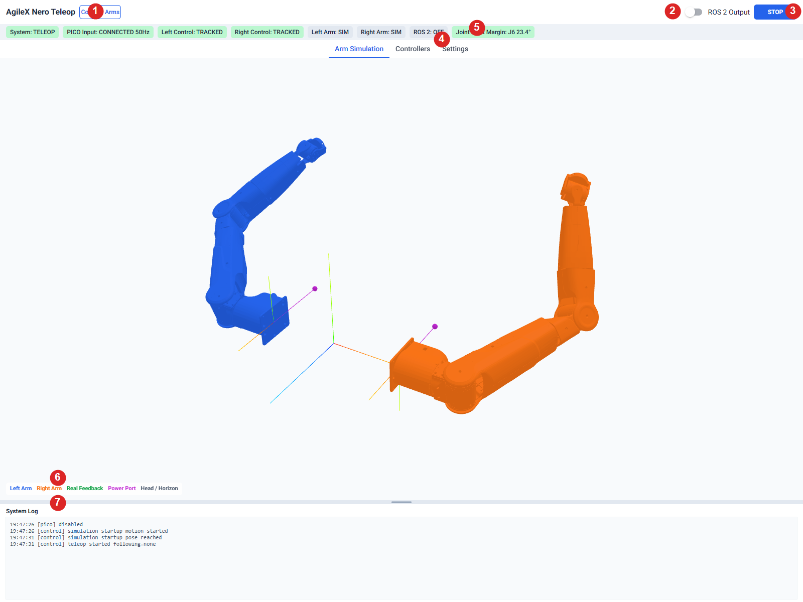
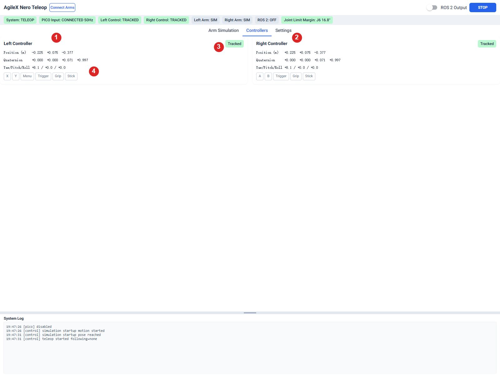
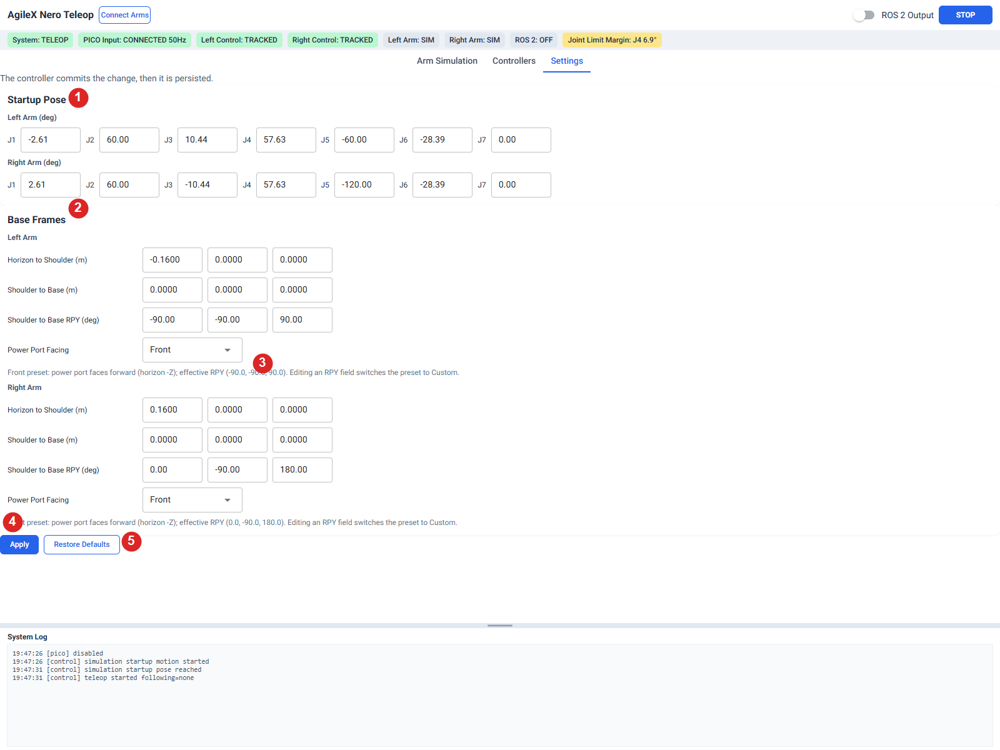
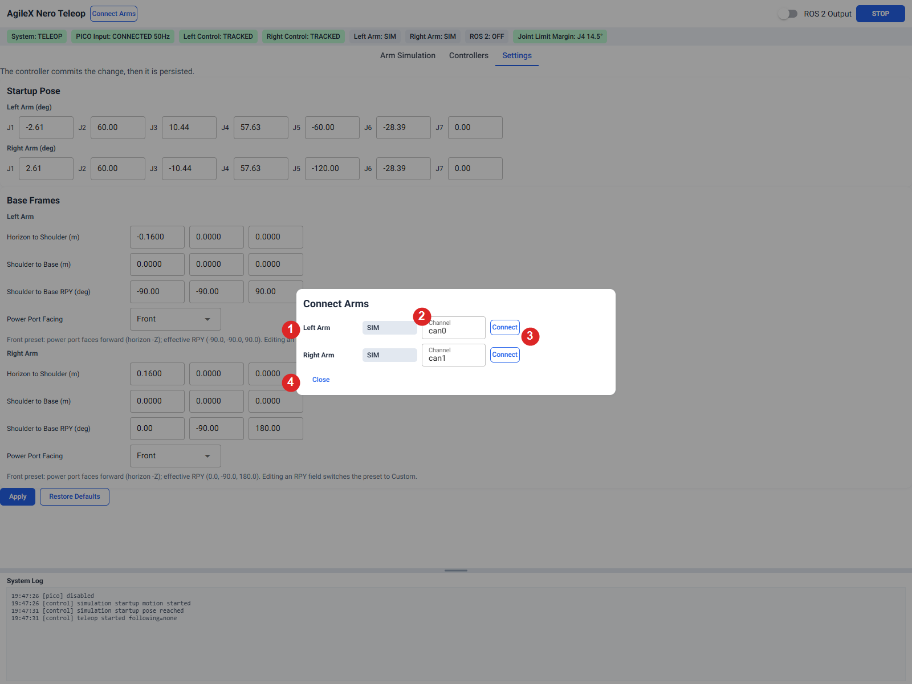
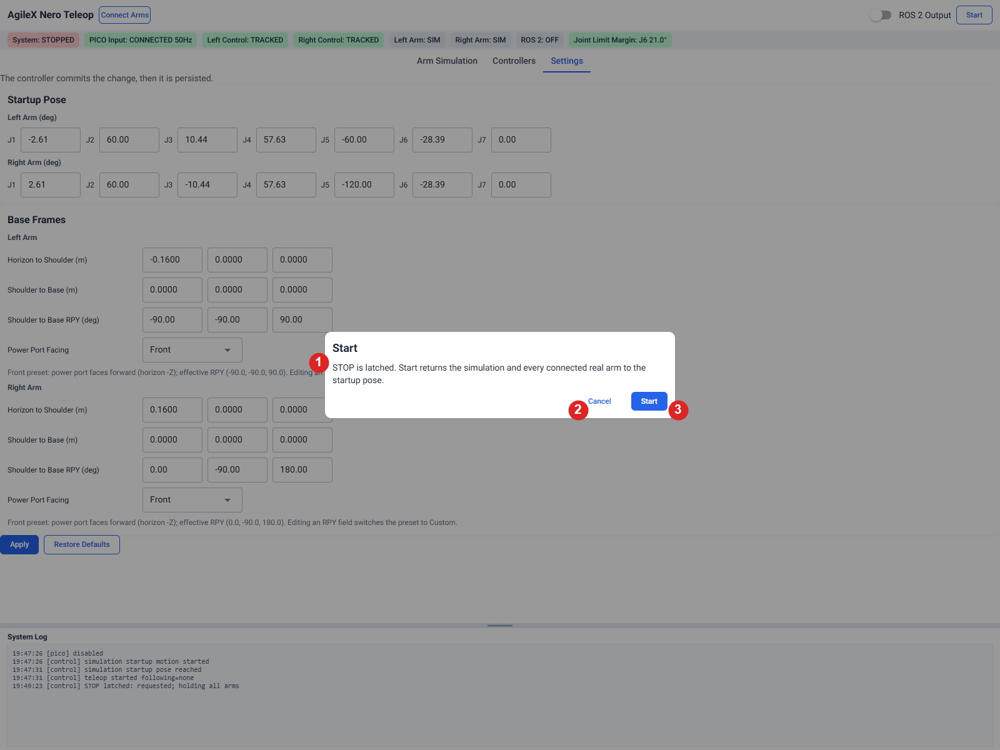
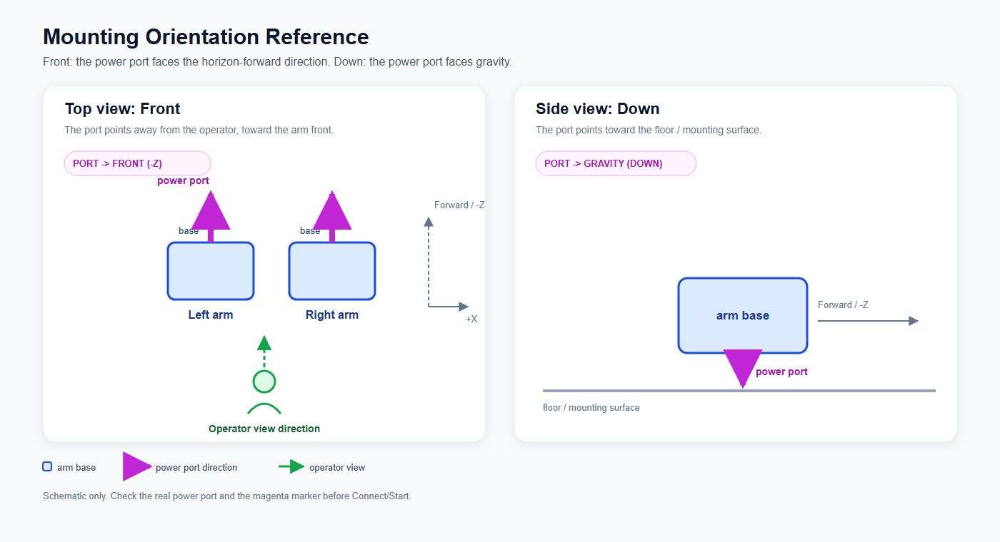

# PICO × AgileX Nero Teleop

PICO 4 Ultra controller teleoperation for AgileX Nero seven-axis arms. The host converts controller poses into joint targets and provides a browser UI for the 3D model, real-arm feedback, connection control, and mounting settings. Single-arm and dual-arm setups are supported.

## Quick Start

Requirements:

- Linux host, Ubuntu 24.04 recommended, with SocketCAN support.
- Python 3.12.
- PICO 4 Ultra and controllers with USB debugging enabled.
- AgileX Nero arm and a compatible USB-to-CAN adapter.

### Install

On a new host, install the system packages first:

```bash
sudo apt update
sudo apt install -y git build-essential python3.12-dev python3.12-venv adb usbutils can-utils libusb-1.0-0
```

Then install the Python environment and build the IK extension:

```bash
cd <project-dir>
python3.12 -m venv .venv
source .venv/bin/activate
python -m pip install -r requirements.txt
python -m pip install -e ./third_party/pyAgxArm
python setup.py build_ext --inplace
```

The last command builds the IK extension. Rebuild it if you change Python or the platform.

### Prepare PICO and CAN

Connect the headset and the USB-CAN adapter directly to the Linux host, then run:

```bash
adb devices
adb install -r apk/generated_apk/pico_head_relative_pose.apk
ip -details link show can0
```

Accept the USB-debugging prompt in the headset. If `can0` is missing or down:

```bash
sudo modprobe gs_usb
sudo ip link set can0 type can bitrate 1000000
sudo ip link set can0 up
```

If `adb` reports a permission error, install the udev rules and re-login:

```bash
sudo apt install android-sdk-platform-tools-common
sudo usermod -aG plugdev "$USER"
```

### Run

```bash
env -u PYTHONPATH python run.py --no-browser --port 8095
```

Open the URL printed in the terminal. Use `--demo` instead for a UI-only check; demo mode does not enable an arm.

## GUI

The screenshots below are from pure simulation.



1 Connect Arms · 2 ROS 2 Output · 3 STOP · 4 pages · 5 status · 6 legend · 7 System Log.

The main window has a top control bar, a status bar, page tabs, the 3D view, a color legend, and the System Log.

- **Connect Arms** opens the channel dialog.
- **Start** is available in STOPPED once settings are saved. It moves connected arms to the Startup Pose before following; using Start again after STOP repeats this sequence.
- **STOP** stops advancing new targets and holds the arm. It is not a physical emergency stop.
- **ROS 2 Output** is an optional switch; leave it off unless you need ROS topics.
- The status bar shows Pico input, controller tracking, arm state, ROS state, and joint-limit margin.
- Closing the browser does not stop the program. Press **Ctrl+C** in the terminal to exit.

### Pages

- **Arm Simulation**: target models, real-arm feedback, mounting markers, and the System Log.
- **Controllers**: per-controller pose and raw button state; this page is read-only.
- **Settings**: Startup Pose, Base Frames, mounting direction, Apply, and Restore Defaults.



1 Left controller card · 2 Right controller card · 3 tracking state · 4 raw button display.

The cards show pose, quaternion, yaw/pitch/roll, and tracking state. The buttons are read-only indicators, not commands.



1 Startup Pose · 2 Base Frames · 3 Power Port Facing · 4 Apply · 5 Restore Defaults.

- **1 Startup Pose**: seven joint targets per arm, in degrees.
- **2 Base Frames**: translation and RPY fields; keep the defaults unless the arm has been measured.
- **3 Power Port Facing**: choose Front, Down, or Custom to match the physical port.
- **4 Apply**: validates, applies, and saves the settings. It is disabled while a transaction is in progress and rejected while a real arm is following; press STOP first.
- **5 Restore Defaults**: removes the saved settings and restores defaults.

### Connect Arms dialog



1 Left/right arm rows · 2 Channel · 3 Connect / Disconnect · 4 Close.

- **1 Left/right arm rows**: connection state for each side.
- **2 Channel**: the SocketCAN interface for that side, for example `can0`.
- **3 Connect / Disconnect**: Connect connects and enables the arm; Disconnect releases it.
- **4 Close**: closes the dialog without changing the connection.

### Start dialog



1 Message · 2 Cancel · 3 Start.

- **1 Message**: Start returns to the Startup Pose; after STOP it repeats this sequence.
- **2 Cancel**: closes the dialog without starting.
- **3 Start**: begins startup and alignment.

### Settings

- **Front** means the power port faces the horizon-forward direction; **Down** means it faces gravity. The magenta marker shows the selected direction.
- Keep Startup Pose and Base Frames at their shipped defaults for a first installation; edit them only after checking the real arm.
- The shipped defaults are the original model's Front installation. Use **Custom** only with values measured from the actual arm.



## For developers

See [dev/README.md](dev/README.md).
