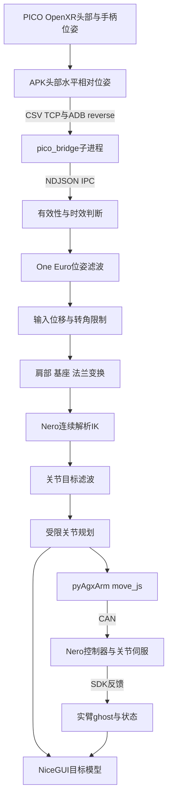

# PICO × AgileX Nero 遥操上位机（底座摆放版）

基于 **PICO 4 Ultra、连续解析逆运动学和松灵 pyAgxArm SDK** 的七轴机械臂遥操作程序。操作员移动左右手柄，上位机将其转换为对应 Nero 臂的关节位置目标；浏览器提供三维模型、实臂反馈、连接控制与安装参数设置。

本文对应 **2026-11-09 的本地修改版**：包含左右独立的电源口朝向预设、跨页面设置事务、超时取消、持久化失败恢复和 Start 门禁。

本交付包以公开上游 **main 基线**为基础，只新增电源口/底座摆放（Power Port Facing）功能；**不包含** SLAI、dual-device 等后续仿真扩展。当前公开上游的 clone 不包含本包未推送的改动，请以本包源码为准。

> **Connect 会调用 SDK 连接并使能机械臂；Start 会让已连接实臂向 Startup Pose 运动，再进入跟随。STOP 是停止目标推进并保持关节，不等于物理急停或断电。**
>
> **已知未解决问题（本文只如实记录，未修改相关源码）：实臂反馈过期但 SDK socket 仍打开时，程序可能继续显示 TELEOP、保留旧关节值并继续发送命令；2026-11-08 现场曾出现 stale 警告且被动收帧为零，根因尚未确认、问题尚未根治。现场操作以 STOP + 人工检查为准，详见 §9.2。**

## 目录

- [1. 简介与适用范围](#1-简介与适用范围)
- [2. 已有环境日常启动](#2-已有环境日常启动)
- [3. 完整安装教程](#3-完整安装教程)
- [4. 详细使用流程](#4-详细使用流程)
- [5. 安装方向与设置](#5-安装方向与设置)
- [6. 完整遥操原理](#6-完整遥操原理)
- [7. 参数与命令速查](#7-参数与命令速查)
- [8. 文件结构](#8-文件结构)
- [9. 故障排查与已知限制](#9-故障排查与已知限制)
- [10. 验证与参考资料](#10-验证与参考资料)

> **命令约定**：每段代码块前标注 **PowerShell（Windows）** 或 **Ubuntu（WSL/Ubuntu 终端）**，并说明工作目录；`# 预期` 行说明成功时应看到的结果。需要管理员权限的地方会单独写明。WSL 内的命令不要直接粘贴到 PowerShell。

## 1. 简介与适用范围

本项目将 PICO 左右手柄的 **6D 位姿**映射到左右 Nero 七轴臂，支持只连接一侧。算法链包含位姿滤波、输入步长限制、连续解析 IK、关节滤波及速度/加速度受限规划。NiceGUI 页面显示目标/仿真模型、绿色实臂反馈 ghost、坐标轴、限位余量与日志；ROS 2 话题输出为可选功能。

| 模式 | 启动特征 | 用途 |
|---|---|---|
| 演示 | `--no-pico --demo` | 合成位姿，检查界面与算法；不要连接实臂 |
| 普通 Nero 遥操 | 不加 demo | 真 Pico 输入；连接对应侧实臂后使用 |

**普通 Nero 模式是直接位姿映射，不是按住握把才动的离合控制。** 当前没有夹爪按钮控制、双向力反馈、碰撞规划或实测负载重力补偿。

## 2. 已有环境日常启动

已有环境从本节开始；新电脑先完成第 3 节。

| 项目 | 说明 |
|---|---|
| 项目目录 | 本地 clone/交付目录，下文用 `<项目目录>` 表示 |
| Python 环境 | 已激活的 Python 3.12 venv（创建方法见 §3.3） |
| 本教程统一网页端口 | `8095`（程序默认 8080；占用时从该端口起递增，以终端输出为准） |

如果同一台电脑保留多份源码或多个 Python 环境，各自的 `settings.json`、`logs/` 与运行进程互相独立，修改不会互相同步；不要在同一端口/CAN 上同时启动多个实例。下文命令里的 `<项目目录>` 换成实际的源码目录即可。

### 第一步：Windows PowerShell 附加设备

```powershell
usbipd list
# 用本次列表中的实际 BUSID 替换下面两个占位符
$PicoBusId = '<PICO_BUSID>'
$CanBusId = '<CAN_BUSID>'
usbipd attach --wsl --busid $PicoBusId
usbipd attach --wsl --busid $CanBusId
```

以上在 **PowerShell** 中执行；工作目录任意。`usbipd list` 的 STATE 列 `Shared` 表示已共享，`Attached` 才表示当前已交给 WSL；两个设备都应为 `Attached`。BUSID 随插口/机器变化，不能固定照抄。若已经显示 `Attached`，跳过对应 `attach`；重复 attach 报 `already attached` 也可继续。首次 `bind`、设备识别与 `adb` 授权见第 3 节。

### 第二步：Ubuntu 检查并启动

在 **Ubuntu-24.04** 终端执行，不是 PowerShell：

```bash
adb devices
ip -details link show can0
```

以上在 **Ubuntu** 终端执行，工作目录任意。预期：`adb devices` 列表中出现头显且状态为 `device`（不是 `unauthorized`）；`ip -details link show can0` 中出现 `state UP` 和 `bitrate 1000000`。然后进入项目目录启动：

```bash
cd <项目目录>
source .venv/bin/activate     # 若使用项目内 venv；已有环境则激活已有环境
env -u PYTHONPATH python run.py --no-browser --port 8095
```

主终端预期出现 `NiceGUI ready to go on http://127.0.0.1:8095`（实际端口以这一行为准）。`pico_bridge` 子进程的标准输出由 `PicoSupervisor` 写入网页的 UI LogBuffer，所以 `ADB reverse ready ...` 等 ADB/Pico 行通常在网页 **System Log** 中看到，不保证出现在主终端。保持终端运行，在 Windows 浏览器打开该网址；结束时回终端按 **Ctrl+C**，不要直接关掉网页。`env -u PYTHONPATH` 避免其他 Python 工作空间污染导入。不要双击 `run.py`，也不要在已有实例运行时再启动第二个实例。

### 第三步：网页开始

以下以**单左臂**为例（左手柄控制左臂）；右臂或双臂按侧别和通道对应替换，不是唯一配置。

1. **STOP → Settings**：若刚启动还在 STARTUP 动作，先点 **STOP**；选择该侧安装方向，核对 Startup Pose，点 **Apply**。
2. **Arm Simulation**：核对模型基座与实物吻合。
3. **Connect Arms → Left Arm**：填 `can0`，点该行 Connect。
4. Pico 为 CONNECTED、所用左手柄 TRACKED，确认启动运动空间后点 **Start**，完成弹窗核对。
5. 先小幅移动左手柄；停止时点 **STOP**。

## 3. 完整安装教程

### 3.1 硬件与系统

| 类别 | 要求 |
|---|---|
| VR | PICO 4 Ultra、手柄、USB 数据线；开发者模式与 USB 调试 |
| 机械臂 | AgileX Nero 七轴臂、匹配电源、正确 CAN 接线；单/双臂均可 |
| CAN | Linux/WSL 使用 SocketCAN 适配器（如 candleLight/gs_usb 等兼容适配器） |
| 系统 | 推荐 Ubuntu 24.04；Windows 可用 WSL2 Ubuntu-24.04 |
| Python | 本修改版使用 Python 3.12；NiceGUI 固定 3.16.0，其余见 requirements |
| 编译工具 | Linux build-essential；原生 Windows 需 Visual Studio C++ 工具链（x64 Native Tools） |
| USB/CAN 库 | Ubuntu 的 `libusb-1.0-0`（pyusb/gs-usb 需要）；gs_usb 内核模块 |
| 可选 ROS | 同一 Python 环境可导入 rclpy、geometry_msgs、std_msgs |

原生 Windows 代码支持 `agx_cando`，但需要厂商后端、驱动和 DLL；Linux 的 `can0` 不能直接填进 Windows。下文以已实际使用的 WSL2/SocketCAN 为主。

### 3.2 获取完整源码

使用交付的完整 `analytic_control` 文件夹，不只复制入口文件。必须保留 `ui/`、`mounting.py`、`pico_bridge/`、两套 URDF、`apk/` 和 `third_party/pyAgxArm/`。

公开上游为 [mm-hand/analytic_control](https://github.com/mm-hand/analytic_control)。**当前上游基线不包含未推送的本地修改**，以下命令只获取上游基线，不代表本地功能已发布：

```bash
git clone --recursive https://github.com/mm-hand/analytic_control.git
cd analytic_control
```

Git 检出缺少 SDK 子模块时：

```bash
git submodule update --init --recursive
```

交付副本中 SDK 已完整存在则无需为了启动而更新。程序优先导入仓库内 SDK，不能用 pip 最新版文档替代当前版本行为。

### 3.3 Ubuntu / WSL Python 依赖与 IK 编译

新机器安装系统依赖，已有环境跳过已完成部分：

以下在 **Ubuntu** 终端执行，工作目录任意；需要 sudo 密码。

```bash
sudo apt update
sudo apt install -y git build-essential python3.12-dev python3.12-venv adb usbutils can-utils libusb-1.0-0
# 预期：命令成功返回；若提示 adb 包名不同，Ubuntu 24.04 可用 adb 或 android-tools-adb
```

`requirements.txt` 首行注释来自旧开发用的 conda 环境 `mmhand`，它只是提示“安装进已有环境”，不是硬性要求。若已有该 conda 环境，可 `conda activate mmhand` 后直接 `pip install`，不必重建 venv；本 README 以项目内 venv 为例。否则优先激活已有 Python 3.12 venv/Conda，只有没有环境时才创建：

```bash
# Ubuntu 项目根目录；创建项目内 venv 并激活
python3.12 -m venv .venv
source .venv/bin/activate
# Windows PowerShell 等价命令：python -m venv .venv; .venv\Scripts\Activate.ps1
```

以下在 **Ubuntu 项目根目录** 执行（先 `cd` 到项目根，并已激活 §3.3 的 venv 或已有环境）：

```bash
python -m pip install -r requirements.txt
python -m pip install -e ./third_party/pyAgxArm
python setup.py build_ext --inplace
python -c "import numpy, nicegui, ik_solver; print('Python / GUI / IK imports OK')"
# 预期：打印 Python / GUI / IK imports OK；构建失败见 §9.1
```

SDK 的 editable 安装同时安装它自身声明的依赖。不要在系统 Python 上用 `sudo pip` 绕过环境管理。

Linux 编译产物是 `ik_solver.cpython-312-...so`，Windows 是 `.pyd`；与系统、架构和 Python 版本绑定，换环境后重新编译。`.pyx` 是算法源码，`.c` 是生成文件。

**原生 Windows：** 在已有 Python 3.12 环境和 **x64 Native Tools Command Prompt for VS 2022** 中执行同样的 pip/build 命令；安装官方 Android Platform-Tools 并把 `adb.exe` 加入 PATH（或设置 `PicoConfig.adb_path`）。实臂另需厂商提供的 `python-can-agx-cando` 插件、`cando.dll` 和 USB-CAN 适配器驱动；它们不在 requirements 中。SDK 文档给出的插件安装方式如下，在已激活的同一个 Windows Python 环境执行；厂商驱动安装如另需管理员权限，按厂商说明处理：

```powershell
python -m pip install "git+https://github.com/agilexrobotics/python-can-agx-cando.git"
# 预期：安装成功；然后按 SDK 文档安装/放置 cando.dll 并接好 USB-CAN 适配器
```

缺少这些组件时采用 WSL2 + SocketCAN 路径。

### 3.4 Windows/WSL2 USB 配置

原生 Ubuntu 跳过本节。Windows 新机器可在管理员 PowerShell 安装：

```powershell
wsl --install -d Ubuntu-24.04
winget install --interactive --exact dorssel.usbipd-win
```

以上在 **管理员 PowerShell** 执行；按提示重启并打开一次 Ubuntu，完成 Linux 用户初始化。连接设备后运行 `usbipd list`，根据设备名称而不是只凭 VID:PID 确认目标。下表只是**示例**，不是任何特定机器的识别结果；不同设备/固件会变，以 `usbipd list` 的实际名称为准：

| VID:PID（示例） | 设备类型（示例） | 用途 |
|---|---|---|
| `2d40:00b7` | PICO / Android | 头显 USB 数据 |
| `1d50:606f` | candleLight USB to CAN | 松灵 Nero |
| `2e88:4603` | COM9 串行适配器 | 另一类设备，不是 Nero 的 SocketCAN |

首次共享需**管理员 PowerShell**；`bind` 必须管理员，`attach` 通常可用普通 PowerShell，若报权限错误再用管理员终端（不要用 `--force`）。替换两个示例 BUSID：

```powershell
$PicoBusId = '<PICO_BUSID>'   # 从 usbipd list 复制实际 BUSID
$CanBusId = '<CAN_BUSID>'
usbipd bind --busid $PicoBusId
usbipd bind --busid $CanBusId
```

之后每次需要附加时，在同一 PowerShell 会话保留/更新上述变量：

```powershell
usbipd attach --wsl --busid $PicoBusId
usbipd attach --wsl --busid $CanBusId
usbipd list
```

预期 `usbipd list` 中两个设备都显示 `Attached`；WSL 内 `lsusb` 能看到对应设备。若 Access denied，使用管理员终端执行 `bind`；不要直接用 `--force` 猜测解决过滤驱动问题。附加后 Windows 原生工具不能同时独占该设备。

### 3.5 Pico 授权与 APK

1. 头显开启开发者模式和 USB 调试，用数据线连接并佩戴头显接受授权。
2. WSL 用户完成 USB attach 后，在 **Ubuntu** 执行 `adb devices`；应显示 `device`。若 adb 不在 PATH，可在 `PicoConfig.adb_path` 指定路径；bridge 的查找顺序是配置路径、`%LOCALAPPDATA%\Android\Sdk\platform-tools\adb.exe`、PATH、`~/Android/Sdk/platform-tools`。
3. `unauthorized` 需在头显接受授权；没有设备检查数据线/附加/驱动。
4. 首次安装或更新 APK，在项目根目录执行：

   ```bash
   adb install -r apk/generated_apk/pico_head_relative_pose.apk
   ```

包名是 `com.mmhand.pico_head_relative_pose`。可用 `adb shell pm list packages | grep com.mmhand` 确认已安装。启动 `run.py` 后 `pico_bridge` 子进程会自动执行 `adb reverse` 并启动该应用；**无需每次重装 APK，也不要再手动启动第二个 bridge**。`adb install -r` 只在首次安装或 APK 更新时执行。

若 Ubuntu ADB 权限不足，检查 udev 规则及用户设备权限；可安装 `android-sdk-platform-tools-common`，需要时加入 plugdev 后重新登录。不要在 Windows 和 WSL 同时运行 ADB 争用头显。

通常不需自行构建 APK。开发头显程序时参照 `apk/Cargo.toml` / `apk/build.sh`：Rust（Cargo.toml 要求 ≥ 1.82）、`cargo apk`（cargo-apk，需另行安装）、JDK 17、Android SDK/NDK、OpenXR loader；脚本默认 build-tools 32.0.0、android-31、NDK 25.1.8937393，先核对 SDK/NDK 的实际路径。APK 编译不属于日常遥操启动步骤，失败不应阻塞遥操环境。

### 3.6 SocketCAN 配置

在 Ubuntu 检查：

```bash
lsusb
ip -details link show type can
```

已确认目标适配器为 `can0`、且当前无机械臂控制进程时：

```bash
sudo modprobe gs_usb
sudo ip link set can0 down
sudo ip link set can0 type can bitrate 1000000
sudo ip link set can0 up
ip -details link show can0
```

已 UP 且速率正确时不用重设。重配或重启通道会中断当前 SDK socket，不能边遥操边执行。**ERROR-ACTIVE 是正常 CAN 状态名称**，不要误当故障；ERROR-PASSIVE / BUS-OFF / STOPPED 需要排查。

被动检查：

```bash
timeout 2s candump can0
```

timeout 到时退出124属正常。网卡 UP 不证明机械臂在线；无帧时检查电源/急停、H/L、接地、终端电阻和固件行为。

可选的 `scripts/can0-persist/install.sh` 是**一次性系统级设置**，会修改：

- `/etc/systemd/system/<channel>.service`：设备出现时自动 `ip link set <channel> type can bitrate 1000000` 并 `up`；
- `/etc/sudoers.d/analytic-can-reset`：允许当前用户免密执行 `systemctl restart <channel>.service`，供 `hardware.py` 在 CAN 卡死时自动恢复；
- 启用这些 unit 并尝试立即重启一次。脚本可重复执行；参数缺省为 `can0 can1`。

理解上述系统改动、机械臂已停止/程序已退出、systemd 可用时才手动安装；**不要在实臂运动或遥操过程中执行**：

```bash
# Ubuntu 项目根目录；需要 sudo
sudo bash scripts/can0-persist/install.sh can0
# 预期：生成/启用 can0.service 与 sudoers 规则，无语法错误退出
```

它不是启动网页的必要条件，也不代替 `usbipd attach`；不安装时仍可手动 `sudo ip link ...` 配好 CAN。

### 3.7 首次软件检查

以下在 **Ubuntu 项目根目录** 执行（demo 已隐含 `--no-pico`，不需要再重复）：

```bash
python run.py --demo --no-browser --port 8095
# 预期：打印 NiceGUI ready to go on http://127.0.0.1:<实际端口>；不会自动连接任何实臂
```

保持终端，打开该网址检查界面；**不要在这个模式点 Connect Arms 连接实臂**（演示模式不会阻止连接，连接后仍会下发命令）。验证后 Ctrl+C 退出，再运行真实输入（Pico/USB/CAN 需已按前文准备好）：

```bash
python run.py --no-browser --port 8095
# 预期：主终端 NiceGUI ready；ADB reverse/Pico 状态去网页 System Log 和状态条确认
```

程序会在 `--port` 起 **50 个端口范围**内选择第一个空闲端口；不要保留演示进程又启动第二个实例。复制项目文件夹、刷新网页或双击快捷方式本身不会启动服务。

### 3.8 首次完整走查清单

新机器/第一次实机建议按顺序逐项打勾（下面仍以单左臂为例；右臂/双臂按侧别替换），任一失败先停在 §9 排查，不要跳过：

1. **PowerShell**：`usbipd list` 两个设备均为 `Attached`（Pico 与 CAN 适配器）。
2. **Ubuntu**：`adb devices` 出现 `device`；`ip -details link show can0` 为 `UP` + `1000000`。
3. **Ubuntu 项目根**：`python -c "import numpy, nicegui, ik_solver; print('OK')"` 输出 OK。
4. **Ubuntu 项目根**：demo 启动能打开网页、目标模型随合成手柄运动（不连接实臂）。
5. 真实输入启动：Pico 状态为 CONNECTED、所用左手柄 TRACKED、速率非零。
6. 核对现场急停/供电/运动范围，确认机械臂已固定、周围无人。
7. **STOP → Settings → Apply**：核对安装方向与 Startup Pose（只有 STOPPED/纯仿真 TELEOP 可 Apply）。
8. **Connect Arms**：只连左臂时填 `can0`；连接成功 STOP 锁定，日志出现固件与连接成功。
9. **Start**：勾选“模拟与实臂基座一致”确认，观察实臂回到启动姿态、接管后进入 TELEOP。
10. 先小幅移动，确认方向正确；异常立即 **STOP**，保留终端日志，再按 §9 排查。

## 4. 详细使用流程

### 4.1 界面说明

| 区块 | 内容 |
|---|---|
| Connect Arms | 弹窗内左右独立通道与 Connect / Disconnect；Connect 会连接并使能，成功后才锁 STOP |
| ROS 2 Output | 顶部开关，默认关；解释器没有 rclpy 时显示 UNAVAILABLE |
| STOP / Start | 停止保持；确认后回启动姿态并跟随（仅在 STOPPED 显示 Start） |
| 状态条 | 系统阶段、Pico速率、追踪、实臂状态、ROS、限位余量 |
| Arm Simulation | 蓝/橙左右目标模型，绿色实臂反馈ghost，坐标轴及品红安装箭头 |
| Controllers | 手柄位姿、有效性、按键 |
| Settings | Startup Pose、肩/基座变换、安装朝向、Apply / Restore Defaults |
| System Log | 连接、设置拒绝、IK无解、追踪和反馈警告；底部可拖动分隔条调整高度 |

（界面中 Power Port Facing 位于 Settings → Base Frames 下；本包不带截图，避免把仿真截图当作实机验收。）

### 4.2 输入与安装准备

1. 固定机械臂，确认供电、CAN与现场急停，启动运动范围无干涉。
2. 启动真实输入；使用的手柄应为 TRACKED，Pico 应显示 CONNECTED 和非零速率。
3. 尚未连接实臂时，观察小幅手柄移动与仿真目标方向是否合理。
4. 点 STOP → Settings，配置对应侧朝向、核对 Startup Pose 并 Apply；**实臂正在跟随（TELEOP + following）时 Apply 会被拒绝**，必须先 STOP。
5. 回到 Arm Simulation，对照实物基座位置、方向、左右侧和工具方向；不要用观察相机旋转代替安装变换。

### 4.3 连接通道

| 场景（示例） | Left Arm | Right Arm |
|---|---|---|
| 单左臂 | can0 → Connect | 不连接 |
| 单右臂，唯一适配器 can0 | 不连接 | 手动填 can0 → Connect |
| 双臂 | 实际左通道，例如 can0 | 实际右通道，例如 can1 |
| Windows 原生 | 厂商索引，例如 0 | 另一索引，例如 1 |

以上连接操作在网页 **Connect Arms** 弹窗完成；Linux 填 SocketCAN 名（`can0`/`can1`），原生 Windows 填厂商设备索引（`0`/`1`）。左右不可共用同一通道；重复通道会被拒绝。

一次成功的 Connect 会：识别固件驱动 → `connect`/`enable` → 检查初始反馈 → 该侧状态**直接置为 STOPPED** 并锁定；不会先进入 READY 再转 STOP。**Connect 不是只读扫描，会真实使能机械臂**；连接前确认机械臂周围安全、已固定、急停可用。

### 4.4 Start与正常跟随

1. 核对 Startup Pose 的七个关节角（界面单位为度）。
2. 头显和手柄处于准备姿态，点 Start；**只有连接了实臂时**弹窗才要求勾选“模拟与实臂基座一致”。
3. 程序依次执行：仿真启动轨迹 → 有实臂时 `_finish_startup()` 进入 **ALIGNING** → 每台已连接实臂的 worker 再执行 `move_j` 到启动姿态、切 `js` 伺服接管（约 0.2 s 保持）→ 全部 worker 完成才进入 TELEOP。
4. 先小幅自由空间运动，观察目标与反馈；目标不可达时退回可达区域。

普通模式不需要按握把离合。头部移动也可能改变相对手柄目标，不要假定它与控制无关。TELEOP 是控制阶段标签，不能单凭它证明实际到位或反馈新鲜。

### 4.5 暂停、改装与退出

- STOP：设置停止标志并保持最后目标，不推进新遥操目标，**不切使能/力矩**。对已进入过 following 的实臂仍会发送保持指令。
- 改安装：先 STOP；TELEOP 且实臂 following 时 Apply 会被拒绝，STARTUP/ALIGNING/连接忙碌也会拒绝。设置事务在途或持久化未收敛时 Start 被禁止。
- 恢复：Start 会重新走“启动姿态 + 实臂对齐/接管”，不是从暂停点续播。
- 退出：妥善停放/支撑实臂后，在程序终端 Ctrl+C；关闭网页或合上笔记本不等于结束后台控制，合盖/休眠还可能断 CAN/USB。
- SDK 断开连接与物理断电不同；需要切力矩时按设备规定现场操作。
- FAULT：先读 System Log；FAULT 不会被 Start 清除，通常需要排查后重启整个 `run.py` 进程。

## 5. 安装方向与设置

**下面以左臂为例说明设置；右臂把侧别换成 Right、RPY 换成右侧对应值即可。** 每侧 **Shoulder to Base RPY (deg)** 下的 **Power Port Facing** 提供 Front / Down / Custom。选预设会用权威矩阵回填该侧 RPY；手改任一 RPY 数字会立即自动切换为 Custom；只有 Apply 后才会影响控制与三维。

Front 与 Down 的 RPY 首轮数值如下（Front 是原模型基准，Down 由安装旋转矩阵导出；左右独立）：

| 侧 | Front RPY/° | Down RPY/° |
|---|---|---|
| 左 | `(-90,-90,90)` | `(-90,0,90)` |
| 右 | `(0,-90,180)` | `(90,0,90)` |

旋转约定 `R=Rz(yaw)Ry(pitch)Rx(roll)`。以下旋转都在 horizon 父系中左乘到 Front 矩阵：`R_down=Rx(-90°)·R_front`。它不是给关节加 90°，不改关节零位/反馈/限位，平移也不清零。Euler 存在万向节锁，等价性比较以旋转矩阵为准。

局部参考向量为基座 −X：Front 朝 horizon 前方（−Z），Down 朝重力方向（−Y）。网格能定位连接器/端口面板，但“哪个插座是电源口、实物重装绕哪根轴/哪个方向转”仍是**待现场核对的假设**；数学预设与仿真截图不是实测标定，操作员必须用实物和品红参考标记（直线+端点小球）核对后才能连接/Start。

### 5.1 实物朝“后”或“上”时怎么改

当前 UI 只内置 Front / Down / Custom；**后（Back）和上（Up）没有实现为预设**。方向由矩阵决定，不是靠改 RPY 的某个符号“猜”出来：设 horizon 中前方 `f=(0,0,-1)`、下方 `d=(0,-1,0)`、后方 `b=(0,0,1)`、上方 `u=(0,1,0)`，端口局部向量 `v=(-1,0,0)`，则 `R_front·v=f`。要保持同一安装基准，只需在 horizon 父系左乘一个绕 +X 的旋转：

| 目标朝向 | 左乘旋转 | 端口方向 | 左臂 RPY/°（示例） | 右臂 RPY/°（示例） |
|---|---|---|---|---|
| 前 Front | `Rx(0°)` | `(0,0,-1)` | `(-90,-90,90)` | `(0,-90,180)` |
| 下 Down | `Rx(-90°)` | `(0,-1,0)` | `(-90,0,90)` | `(90,0,90)` |
| 上 Up | `Rx(+90°)` | `(0,1,0)` | `(90,0,-90)` | `(-90,0,-90)` |
| 后 Back | `Rx(180°)` | `(0,0,1)` | `(180,90,0)` | `(0,90,0)` |

使用方式（按需选一种）：

1. **只在一台设备上试用**：Power Port Facing 选 **Custom**，按上表把左右 RPY 填入对应侧（以左臂为例填左列），Apply 后用实物和品红参考标记核对；两块基座独立，另一侧不要照抄左臂数值。
2. **做成正式预设**：在 `mounting.py` 的预设旋转表里增加 `Rx(±90°/180°)·R_front` 对应的条目，并在 UI 的 `Power Port Facing` 选项/标签中注册；RPY 用 `transforms.rpy_deg_from_rotation_matrix()` 从矩阵导出，**以矩阵为准**，不要手算欧拉角只看数字。再次提醒：这只改变安装坐标系，不改关节零位、反馈、限位或平移。

**要点**：

- `Rx(-90°)` 产生“下”，`Rx(+90°)` 产生“上”，`Rx(180°)` 产生“后”；角度符号决定上下，180° 决定前后，不是只把某个 RPY 数字加负号。
- 上表 RPY 由矩阵按本仓库的 ZYX/URDF 约定导出，存在 gimbal 等价编码；改完必须用矩阵/参考标记核对，不能只看 RPY 字符串。
- 如果核对发现**参考向量本身相反**（实物朝向与模型局部 −X 相反），改的是 `mounting.POWER_PORT_LOCAL_VECTOR` 的符号（`(-1,0,0)` ↔ `(1,0,0)`），这会让 Front/Back、Down/Up 整体翻转；同样要用矩阵和品红标记重新核对，不要改关节或限位来补偿。

设置规则：

- `config.py` 是默认值来源；运行后在**项目根**生成 `settings.json` 保存覆盖值，不会改写 `config.py`。仓库刚交付时通常没有这个文件。
- 若保留多份源码/多个环境，它们各自保存 `settings.json` 与日志，不自动同步；改动一份不会影响另一份正在运行的进程。
- Apply 顺序：本地校验 → 获取全局设置事务所有权 → 控制线程校验/接受（带 revision）→ 三维同步 → 写盘。rejected 时不写盘、不改画面。
- 事务在途时面板输入、Apply、Restore 都会被禁用；另一个已开页面提交会得到明确拒绝（`another page is applying settings`），不会交错写文件。
- Restore Defaults：应用 `ControlConfig()` 默认值并删除覆盖文件；Startup Pose 也恢复默认，但实臂要等到下一次 Start 才回新启动姿态。
- 旧设置文件没有 `mounts` 段、只有手动 RPY 时，两侧以 `custom` 承接原 RPY；若 `mounts` 标签与 RPY 矩阵不一致，文件会被判无效并忽略。
- 已开页面按 revision 同步；同步时未提交的编辑会被新有效配置替换，并显示“Settings changed in another page”。
- 写盘/删除失败会先恢复文件快照，再请求控制器回滚；只有“回滚确认 **且** 文件恢复成功 **且** 事务开始前本来就是一致的（`was_converged_before_begin`）”才显示已回滚并允许 Start。未确认时显示实际有效配置，START 保持禁止，直到一次健康的 Apply/Restore 成功。

## 6. 完整遥操原理

### 6.1 总体架构



父进程含UI、控制线程、SDK及可选ROS输出；bridge子进程管理ADB、头显TCP和IPC，避免ADB重试直接堵塞控制线程。

默认控制目标 50 Hz（`MotionConfig.command_hz`），GUI 刷新 30 Hz（`GuiConfig.refresh_hz`）是配置值；三维 scene 刷新固定为 10 fps（`ui/scene.py` 中的字面量，不在 `config.py`）。这些都不是硬实时或实际显示性能保证，浏览器/显卡可能达不到。Pico 输入帧率显示在状态条，它是输入帧速，不等于关节命令频率。

### 6.2 Pico采集和坐标定义

`apk/src/lib.rs`通过OpenXR取得头部和左右grip pose，要求位置/姿态有效。horizon原点在头部位置，只保留水平朝向；`yaw_only`将头部四元数的(y,w)归一化，清除(x,z)。

令W为OpenXR local，H为上述水平参考系，C为手柄：

```text
p_HC = R_WH^T (p_WC − p_WH)
R_HC = R_WH^T R_WC
```

因此头部平移/转向会改变输入映射。horizon中+X向右、+Y向上、−Z向前；位置单位米，四元数为(x,y,z,w)。

APK 连接**头显内部**的 `127.0.0.1:29761`；`adb reverse` 把它转发到 PC 的 9100（`PicoConfig.device_port` / `vr_port`），bridge 解析后经 `127.0.0.1:9101` 的 NDJSON 发给父进程（`IpcConfig.port`）。线上每帧为一行 19 字段 CSV：

```text
timestamp,left_valid,lpx,lpy,lpz,lqx,lqy,lqz,lqw,right_valid,rpx,rpy,rpz,rqx,rqy,rqz,rqw,left_buttons,right_buttons
```

解析检查字段数、两侧有效位（`0/1`）、数值有限性和按钮 32 位整数范围；无效帧整行丢弃。父进程用**PC 接收时的单调时钟**判断 pose 时效：默认超过 `0.25 s` 不再向上层提供 pose；`0.5 s` 用于“输入是否仍连接”的界面显示（`PoseInputConfig`）。这不是端到端延迟测量，APK 自带的时间戳不参与该判断。

> **不要自行连接 9101 做观测。** 该 NDJSON IPC 只维护**一个客户端**：新的连接会替换并关闭旧连接，把正在运行的控制进程挤掉，输入随即中断。需要观测就用 GUI 的 System Log 并保留 `logs/control.log`。

bridge 还轮询 ADB reverse 与头显焦点：Pico 的 `HandDialogActivity` / `PicoXR_CustomDialog` 等系统浮层会抢走输入焦点，focus guard（`PicoConfig.focus_guard`，默认每 0.5 s 检查一次，恢复动作有最小间隔）识别 `mCurrentFocus` 后 force-stop 配置的浮层包（`overlay_package`，默认 `com.picovr.systemext`）并复查焦点；焦点恢复失败只会记日志。它不是通用的头显系统修复，也不要为此全局关掉手势追踪。

### 6.3 两级滤波和输入限制

One Euro通过估计速度动态调整一阶低通截止频率：

```text
dx       = (x − x_prev_raw) / dt
dx_hat   = LowPass(dx, d_cutoff)
cutoff   = min_cutoff + beta * abs(dx_hat)
alpha    = 1 / (1 + 1 / (2π*cutoff*dt))
x_hat    = alpha*x + (1−alpha)*x_hat_prev
```

慢动作更平滑，快动作提高截止频率减少滞后。默认 `min_cutoff=3`、`beta=0.05`、`d_cutoff=1.0`；位置/位姿输入用一组滤波器，IK 输出的七维关节目标用另一组独立滤波器（`FilterConfig.pose` / `ik_output`），参数相同但状态不共享。

- 位置按 xyz 三轴分别滤波，每轴 cutoff 可不同。
- 姿态先做 `q/−q` 符号对齐（避免欧氏分量平均跨越符号），再对四个分量滤波并归一化；这**不是** SLERP/流形滤波。输入转角限制才使用最短弧 SLERP 插值。
- 输入端每步位置变化不超过 `min(0.04 m, 2 m/s × dt)`，转角不超过 `min(0.16 rad, 4 rad/s × dt)`；这是**手柄目标**限速，不是实臂速度上限。
- IK 后的七维关节目标先选邻近的 2π 等价角（避免绕整圈），再做 One Euro 滤波。
- pose 失效时清空位置/姿态滤波状态并保持上一目标；普通模式不会因此建立相对离合锚点。

### 6.4 手柄到法兰的变换链

T_AB将B中坐标映射到A；H=horizon，S=该侧肩，B=基座，C=手柄，F=法兰：

```text
T_SC = inverse(T_HS) * T_HC
T_SC_scaled: 只对平移乘s，保留旋转
s = robot_size / human_size = 1.45 / 1.0
T_BF = inverse(T_SB) * T_SC_scaled * T_CF
T_HB = T_HS * T_SB
```

放大的是**相对肩部的平移**，不是所有世界坐标或旋转。默认左右肩x为−0.16/+0.16m；工具偏置T_CF默认平移(0,−0.03,0.065)m、RPY(0,−180,90)°。

frames.py/mounting.py的同一有效T_SB供控制、目标模型、实臂ghost和坐标轴使用。安装补偿不应通过改关节零位实现。

### 6.5 七轴连续解析IK

`ik.py::NeroIK`包装Cython `ik_solver.pyx`，不是把手柄笛卡尔目标直接交给SDK求解：

1. 目标法兰位姿先经固定偏置 `T_LINK7_TO_FLANGE`（RPY `(-90,0,-90)`、平移 `(0.032,0,-0.0235) m`）转为解析模型 link7 目标。
2. 把 shoulder→wrist 距离钳制到 `[1.05×|l_se−l_ew|, 0.95×(l_se+l_ew)]`（`IkConfig.reach_min_ratio` / `reach_max_ratio`）；只平移末端参考点，不保证所有姿态可解。
3. 以冗余臂角 theta0 参数化多解，枚举肩/肘/腕分支，剔除超出关节范围的候选。
4. 已有上一帧解时，只在前一 theta0 的 `±0.7 rad` 窗口内取 50 个局部点搜索；还没有上一帧解（`theta0_prev is None`）时允许初始化全局搜索；之后默认 `enable_global_fallback=False`，无解不会悄悄做全局重搜。
5. 结合关节速度/加速度变化、FK 位姿误差、臂角变化和限位代价评分，并对分支切换的关节跳变（0.2 rad）和最小收益（0.5）设门禁。

实际权重来自config.py的IkConfig，不是solver裸默认值；本配置w_vel=w_acc=0，不能说所有评分项都启用。连续性也来自局部搜索、分支门禁、滤波和规划。

无解返回None，规划器保持上一目标并记录原因，不会自动绕障。尺寸、零位约定、关节范围由NeroParams.default()提供，更换网格不等于完成运动学适配。

### 6.6 关节规划和臂SDK

`motion.py::ArmMotionPlanner`选择限位内最近等价角，约束目标速度、加速度、单步变化并避免越过目标。默认限位边距0.035rad（约2°），前四轴vmax=0.4rad/s、后三轴0.5rad/s，amax均1rad/s²，单步0.03rad。

这些限制针对**发送目标**；设备实际速度和跟随误差由底层控制器及负载决定。

| 阶段 | hardware.py / pyAgxArm当前调用 |
|---|---|
| SDK加载 | 若本地 `third_party/pyAgxArm` 存在，先把它插入 `sys.path` 再 `import pyAgxArm`；选择 Nero 与平台后端 |
| 连接 | 固件识别（auto 时先 `connect`/`enable` 探测）、最终 `connect`+`enable`、检查初始反馈；设置 `speed_percent=20` |
| 启动 | j模式下按关节轨迹调用move_j |
| 接管 | 切js，约0.2s发送保持目标 |
| 遥操 | move_js(q)，七轴关节位置命令 |
| 反馈 | get_joint_angles及1–7轴get_motor_states，检查SDK时间戳推进 |
| 传输 | Linux SocketCAN / Windows agx_cando，默认1Mbps |

固件驱动映射由 `_firmware_name()` 决定：`>=1.20` → `v120`，`1.12–1.19` → `v112`，`1.11` → `v111`，可解析的更老版本 → `default`；无法解析的版本字符串会报错，不会静默回退。现场日志中曾出现 `1.21` 被映射为 `v120` 的记录；以你的设备日志为准。连接时 `v112/v120` 直接依赖 `enable()` 后的 SDK push 行为，更老驱动额外调用 `set_normal_mode()` 请求 CAN push；旧固件上两次紧邻的 `set_normal_mode()` 可能再次关闭 push，所以代码有 0.2 s 间隔和“时间戳持续前进”校验。**不要靠反复猜固件或反复 `set_normal_mode` 当通用修复**：先看日志里的 `detected Nero arm_firmware`，必要时才显式设置 `RealArmConfig.firmware`。陈旧反馈时的自动 push 重试路径存在，但其现场限制见 §9.2。

伺服接管前显式切 `j`→`js` 并关闭 SDK 的运动模式自动切换，由上位机管理 j/js。SDK 关节限位开关配置默认 `False`（`sdk_joint_limits_enabled=False`，代码仍会调用 `set_joint_limits_enabled(False)`），但上位机仍按 `NeroParams.default()` 的关节限位与边距剪裁；这不意味着设备没有任何限制，也不代表 SDK 侧不做保护。

主机生成位置目标，电机闭环在机械臂控制器内。当前规划器不使用新鲜实臂误差闭环纠偏，不能将目标模型运动等同实物跟随，也不是上位机力矩控制器。

### 6.7 可选ROS 2输出

顶部 `ROS 2 Output` 开关默认关闭。需要时先保证**运行 GUI 的同一个解释器**可导入 `rclpy`、`geometry_msgs`、`std_msgs`；另一个 shell 能运行 `ros2` 并不代表当前 venv/conda 环境可导入。安装 ROS 建议在目标环境用 ROS 官方/robostack 的匹配版本，不把 ROS 依赖写进 requirements。

- 输入：`/read_pose/poses`、`/read_pose/buttons`、`/read_pose/tracked`。
- 臂状态：`/nero/{left,right}/current_joint_angles_deg`、`target_joint_angles_deg`、`current_end_effector_pose`、`target_end_effector_pose`。
- 关节数组为**度**，位姿位置为米；位姿frame_id默认`pose_input_horizon`。

这只是可选话题输出，不自动建立 ROS 2 Control/MoveIt 链；bridge 发布输入话题，控制进程发布臂话题。未连接臂时 current 可来自仿真，已连接时也可能反馈陈旧，订阅方不能仅凭话题名判断它是新鲜测量。

### 6.8 控制状态机与停止语义

主循环以 `MotionConfig.command_hz=50` 跑状态机，快照每 tick 发布给 GUI：

| 阶段 | 含义与进入条件 |
|---|---|
| STARTUP | 启动/Start 后仿真模型按关节轨迹回 Startup Pose |
| ALIGNING | STARTUP 完成且有实臂时先进入本阶段；随后各侧 worker 执行 `move_j` 到启动姿态 → `js` 接管保持，全部完成才结束 |
| TELEOP | 正常遥操：每 tick 采样 pose→滤波/限幅→坐标变换→IK→关节滤波→规划→下发至实臂/更新仿真 |
| STOPPED | STOP/连接实臂/对齐失败等锁定；停止推进新遥操目标，对 following 实臂继续发保持目标 |
| FAULT | 控制循环异常或未被停止标志解释的对齐异常，经 `_fail()` 进入；不会被 Start 清除，排查后重启进程。普通连接失败可只标记该侧 ERROR，不等于全局 FAULT |

STOP 只置停止标志并保持最后目标（`_hold_following`），**不调用 `disable`/不切力矩**；Start 走 `_reset_stop` → 重新启动/对齐。设置修改只在 STOPPED 或纯仿真 TELEOP 接受；TELEOP 且实臂 following 时要求先 STOP。反馈刷新与命令发送解耦：`refresh_feedback()` 返回 False（stale）时主循环可能仍处 TELEOP 并继续用旧值发目标，这是 §9.2 未解决问题的来源。

## 7. 参数与命令速查

| 参数 | 默认与含义 |
|---|---|
| 网页 | `127.0.0.1:8080`；本教程习惯用 `--port 8095`，占用时在 50 个端口内递增 |
| Pico APK → 头显本地 | TCP `127.0.0.1:29761` |
| ADB reverse → PC 接收 | 头显 `29761` → PC `127.0.0.1:9100`（`PicoConfig.vr_port`） |
| IPC | `127.0.0.1:9101`，仅允许一个客户端（不要旁路连接） |
| 控制 / GUI / scene | 50 Hz / 30 Hz（配置）/ fps 10 |
| pose 有效 / 输入连接显示 | 0.25 s / 0.5 s |
| 实臂反馈陈旧 | 0.25 s；当前警告/恢复路径**不保证**自动全停 |
| SDK speed_percent | 20（下发目标前的 SDK 侧比例）；与主机侧目标限速分别存在 |

以下参数来自 `run.py::parse_args`；`PORT=0`（默认）时使用 `config.py` 默认值，并从该端口起在 50 个端口内找空闲口：

```text
--no-pico       不启动 pico_bridge，但仍在等 IPC 输入（没有 bridge 就没有 pose 帧）；不等于 --demo
--demo          合成输入；隐含 --no-pico，并改用 DemoPoseSource
--headless      不启动 NiceGUI
--duration SEC  仅 headless 时的运行秒数；0 表示一直运行到 Ctrl+C
--port PORT     网页优先端口（默认 0 → 8080）
--vr-port PORT  PC 的 Pico 接收端口（默认 0 → 9100）
--ipc-port PORT 进程间端口（默认 0 → 9101）
--no-browser    不自动打开浏览器
```

常用组合（在 **Ubuntu 项目根** 执行）：

```bash
python run.py --demo --no-browser --port 8095              # 离线看界面，不连实臂
python run.py --no-browser --port 8095                     # 真实 Pico + 可连接实臂
python run.py --demo --headless --duration 2               # 合成输入无界面自检，2 秒退出
```

安装方向/启动姿态用 Settings；滤波、IK、限速和工具偏置主要在 `config.py`。修改源码必须结束旧进程再重启，浏览器刷新不会重载 Python；`--headless --duration` 可用于不弹网页的离线启动检查。

## 8. 文件结构

```text
analytic_control/
├── run.py                 # 总入口、端口选择、子进程监督与收尾
├── config.py              # 不可变配置类与默认参数
├── controller_state.py    # 快照、命令、设置事务与全局所有权
├── control_loop.py        # 启动/对齐/遥操/停止状态机
├── hardware.py            # SDK装载、固件、CAN、j/js与反馈
├── joint_feedback.py      # 关节与电机反馈读取、格式检查
├── ipc.py                 # TCP/NDJSON与Pico文本帧解析
├── pose_source.py         # 真Pico/演示输入源及时效
├── filters.py             # One Euro、四元数处理、输入限制
├── frames.py              # 手柄/肩/基座/法兰变换链
├── mounting.py            # 安装预设唯一来源
├── transforms.py          # 刚体变换、四元数、RPY
├── ik.py                  # NeroIK包装、法兰偏置与可达范围
├── ik_solver.pyx          # Cython解析IK/FK与连续分支
├── setup.py               # 编译ik_solver
├── motion.py              # 限位、限速限加速度、启动轨迹
├── settings_store.py      # settings.json校验/迁移/保存/恢复
├── logging_utils.py       # 界面、控制台、轮转文件日志
├── ros_output.py          # 可选Nero状态话题
├── read_joints.py         # 独立读取工具，勿与实臂控制随意并用
├── pico_bridge/
│   ├── __main__.py        # 子进程CLI和父进程退出监测
│   ├── bridge.py          # ADB/TCP/IPC、状态与焦点
│   └── ros_output.py      # 可选/read_pose话题
├── ui/
│   ├── app.py             # 布局、按钮、状态刷新
│   ├── scene.py           # URDF/STL、目标及反馈ghost
│   ├── controllers.py     # 手柄页
│   └── settings.py        # 表单、安装朝向、提交/恢复
├── apk/
│   ├── src/               # Rust/OpenXR与TCP发送
│   ├── java/              # Android Activity
│   ├── generated_apk/     # 可安装APK
│   ├── runtime_libs/      # OpenXR loader
│   └── build.sh           # 可选APK构建/签名
├── nero_urdf/             # Nero模型与网格
├── third_party/pyAgxArm/  # 松灵SDK子模块
├── scripts/can0-persist/  # 可选CAN systemd/权限安装
├── test/                  # 离线算法、假硬件、IPC、GUI回归
├── requirements.txt       # Python依赖
├── settings.json          # 运行时可生成，本地覆盖
└── logs/                  # control.log及轮转日志
```

`.so/.pyd`、`ik_solver.c`、`build/`、`__pycache__/`是构建/运行产物，不是另一套算法。docs 中的历史验收记录不代表当前实机验收。

## 9. 故障排查与已知限制

### 9.1 按现象找入口

| 现象 | 先查 |
|---|---|
| 网页无法访问 | 程序终端是否运行、有无异常、实际打印端口 |
| 缺少朝向控件 | 是否运行修改版；结束旧进程重启，再刷新 |
| ik_solver导入失败 | 同一Python/平台重新build_ext |
| Pico WAITING/0Hz | adb devices、头显授权、APK、USB attach |
| Pico CONNECTED但手柄LOST | 佩戴、追踪、Controllers、应用焦点警告 |
| can0不存在 | usbipd Attached、lsusb、gs_usb，别误用COM9 |
| ERROR-PASSIVE/BUS-OFF | 停放/支撑实臂并退出程序后检查上电、接线、速率和终端电阻；装过 can0-persist 时可 `sudo systemctl restart can0.service`，未装则按 §3.6 的独立命令依次 down、设速率、up |
| CAN 拔插后一直不通 | 先退出程序，再 `sudo systemctl restart can0.service`（自动 bounce）；未装脚本时手动重配；不要在实臂运动时执行 |
| IK found no solution | 目标/姿态/限位或局部搜索无解，退回可达区域 |
| another page applying | 等另页完成再重试 |
| not persisted/Start blocked | 写盘或回滚未收敛，修复文件访问后Apply/Restore |
| ROS UNAVAILABLE | 普通遥操可关闭；需要时检查同一解释器的ROS库 |
| WSL localhost代理提示 | 不单凭提示判失败，看本地HTTP和后续日志 |

### 9.2 实物突然不动

1. 先STOP，记下时间，不连续Start或盲目重连。
2. 看Pico速率与TRACKED；失效输入会保持上一目标。
3. 看IK holding / target recovered；不可达目标会暂停推进。
4. 看`joint feedback unavailable ... stream is stale`、`re-requested CAN push`及CAN状态。
5. 保留日志并停止后，可用`timeout 2s candump can0`被动检查；有帧需区分类型，无帧不能直接判定电机损坏。

**已知软件问题（尚未修复，本文只记录）：** 反馈过期但 SDK socket 仍打开时，`refresh_feedback()` 返回 `False` 并告警/尝试 push 恢复；主循环**可能仍保留旧关节值、显示 TELEOP 并继续发送命令**。2026-11-08 现场出现过此类 `stream is stale` 警告，且 `candump` 被动收帧为零；具体物理原因未最终确认。本轮只修订文档，**没有修改该源码路径，问题仍未解决**，不要依据 TELEOP 或绿色 ghost 判断实臂反馈新鲜。

SDK socket真正关闭的另一条路径会标记ERROR并锁STOP。不能因此声称“所有反馈超时都会自动全停”。反馈异常先由操作员停止并检查电源、急停、线路和驱动状态，再决定恢复。

### 9.3 能力边界

- 无自碰撞/环境碰撞检测，不保证任意手柄目标可达。
- 无上位机力矩闭环、双向力反馈或实测重力补偿。
- 安装物理轴向需实物核对，数学验证不等于标定通过。
- 网页关闭/后台冻结不是已验证的硬件停止触发。
- 目标发送、SDK反馈、新鲜实测到位是不同事实，ghost和TELEOP不能代替精度验收。
- WSL USBIP和浏览器不是硬实时链路；真实GPU帧率与端到端延迟未全面验收。

## 10. 验证与参考资料

### 10.1 离线验证

同一环境、项目根目录，不连接真实机械臂：

```bash
# Ubuntu 项目根，且不要连接真实机械臂
python -m pytest -q -p no:cacheprovider
python run.py --demo --no-browser --headless --duration 2
# 预期：测试通过；headless 运行在 2 秒后退出
```

本交付包（main 基线 + 底座摆放功能）在纯仿真环境运行全量测试记录为 **147 passed**（2026-11-10）；只证明本包算法、假硬件、IPC 和模拟 GUI 回归，不代表实机负载/安全/精度。完整开发分支另有历史验收记录，不适用于本包。默认日志为 `logs/control.log` 及轮转文件，排错保留发生前后日志和当前配置，分享时脱敏头显序列号等无关信息。

### 10.2 参考项目

以下项目用于学习“环境→通信→启动→使用→排错”的文档组织，控制参数以本源码为准，没有照搬其设备命令：

- [mm-hand/analytic_control上游](https://github.com/mm-hand/analytic_control)。
- [AgileX官方pyAgxArm](https://github.com/agilexrobotics/pyAgxArm)：SDK、固件和CAN；优先对照[本地Nero API](third_party/pyAgxArm/docs/nero/nero_api.md)。
- [Key-Zzs/agilex_teleop中文README](https://github.com/Key-Zzs/agilex_teleop/blob/main/README_zh-CN.md)：Nero环境与硬件分层；其LeRobot依赖不是本项目依赖。
- [enactic/openarm_teleop](https://github.com/enactic/openarm_teleop)及[遥操文档](https://docs.openarm.dev/teleop/)：区分单向位置与双向力反馈；本项目没有实现后者。
- [Microsoft WSL连接USB设备](https://learn.microsoft.com/windows/wsl/connect-usb)：usbipd安装与共享/附加。

第三方SDK和模型遵循各自许可，本README不重新授予许可。报告问题时提供源码版本、系统、Python、启动命令、关键日志和脱敏配置，不仅提供“已连接”截图。
